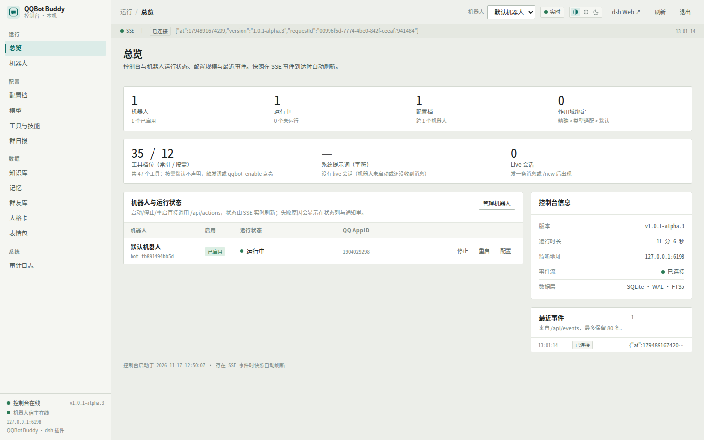
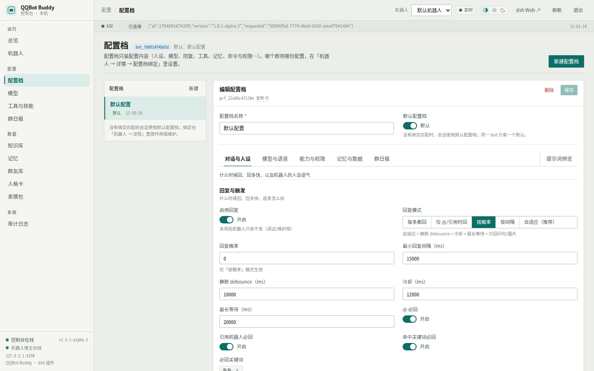
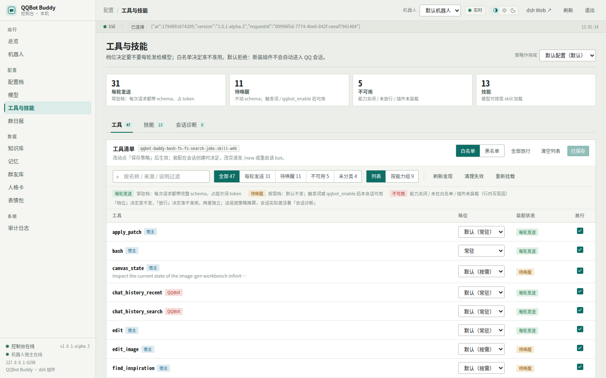
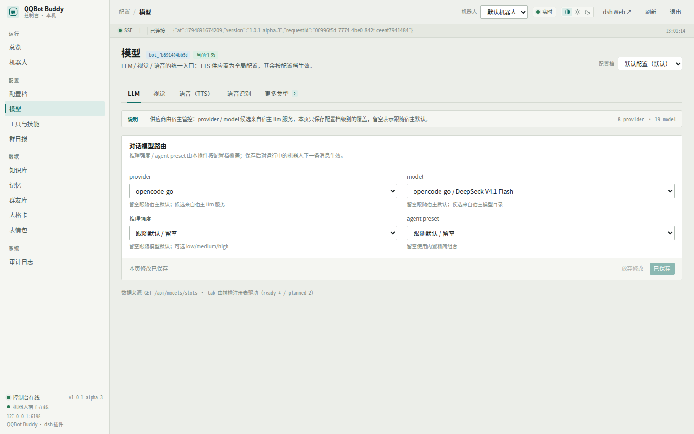
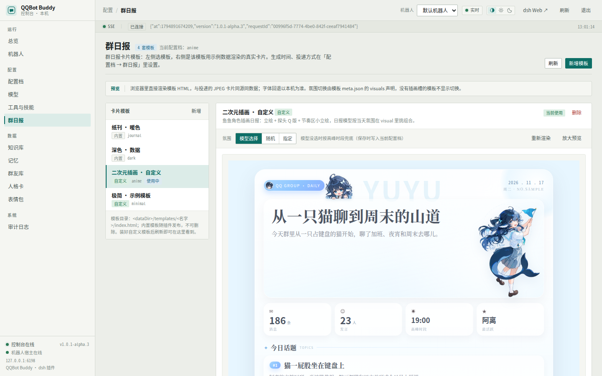
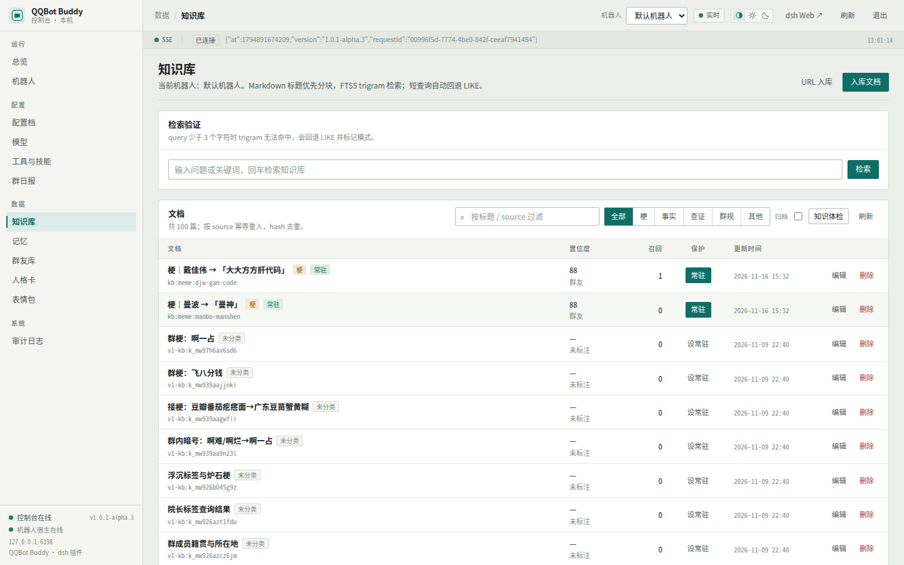

# dsh-qqbot-buddy

把 **DeepSeek Harness（dsh）** 接到 QQ 官方机器人平台的插件。自带独立管理控制台：
多机器人隔离、配置档与作用域绑定、可管理的工具与技能、SQLite + FTS5 长期记忆与知识库、
群友库与人格卡，并提供群日报、语音（TTS / ASR）以及卡片 / 转发 / 引用的结构化渲染。

| 版本 | 发布通道 | 运行环境 | dsh | 许可证 |
| --- | --- | --- | --- | --- |
| `1.0.0-rc.1` | npm `latest` + `next`（预发布 RC） | Node.js ≥ 24 | `0.2.2` – `0.2.x` | MIT |

> 现在还是预发布（RC）：配置项与接口仍会调整，升级前请先备份数据目录（见 [数据与备份](#数据与备份)）。
> `latest` 与 `next` 当前都指向 `1.0.0-rc.1`：装不带标签也行，`@next` 则始终是最新预发布构建。

## 快速开始

```bash
# 1) 装进某个 dsh profile（不写 --profile 时默认 web）
dsh plugin --profile web add dsh-qqbot-buddy          # = @latest
dsh plugin --profile web add dsh-qqbot-buddy@next     # 要最新预发布时用这个

# 2) 重启 dsh，控制台随插件一起启动
dsh web

# 3) 取 token 登录控制台
cat ~/.dsh-qqbot/v2/console-token.txt        # → http://127.0.0.1:6198
```

1. 控制台「机器人」页新建机器人，填 QQ 开放平台的 `appId` / `appSecret`，保存后启动；
2. **先放行自己**：默认 `allowlist` 且名单为空 —— 谁都不理。在 QQ 里私聊或 @ 机器人发一句，
   日志会打印 `访问控制拦截（私聊）：openid=XXX …`，把这个 openid 填进部署配置的
   `access.c2cAllow`（私聊）或 `access.groupAllow`（群，填**群** openid），重启 dsh；
3. 再发一句，确认链路通了（详见 [访问控制](#访问控制谁能触发机器人)）；
4. 想调人设、回复策略、工具与技能，去「配置档」页；想给某个群单独一套策略，
   在「机器人 → 详情 → 配置档绑定」里按 scope 绑定。

## 访问控制（谁能触发机器人）

聊天桥接的默认必须是**拒绝**：装上并填好凭据之后，任何能给机器人发私聊、或在群里 @ 它的人，
都能驱动这台机器上的 agent。所以默认值如下，要放开得自己写：

| 配置项 | 默认 | 含义 |
| --- | --- | --- |
| `access.c2cMode` | `allowlist` | 私聊：只有 `c2cAllow` 里的 openid 会被处理 |
| `access.groupMode` | `allowlist` | 群聊：只有 `groupAllow` 里的**群 openid** 会被处理 |
| `access.c2cAllow` / `groupAllow` | `[]` | 空名单 = 谁都不理 |
| `access.*` 另两个取值 | `open` / `disabled` | `open` 放行所有人（启动时会 warn），`disabled` 全拒 |

在 profile 的 patch 里配置（`dsh plugin --profile <name> ...` 对应的 `cordis.patch.yml`）：

```yaml
- insert:
    - id: qqbot-buddy
      name: dsh-qqbot-buddy
      config:
        access:
          c2cMode: allowlist
          c2cAllow:
            - 'YOUR_C2C_OPENID'      # 私聊：对方 openid
          groupMode: allowlist
          groupAllow:
            - 'GROUP_OPENID'         # 群聊：群 openid，不是群号
```

**openid 从哪来**：被拦截时日志会直接打印（同一个 openid 每进程只提示一次），
也可以在控制台「消息流水」里看——群消息在门控前就已落库，不受白名单影响。

> 放行之后，能进到 agent 的人还能用宿主工具。工具侧的开关是配置档里的
> `tools.mode` / `tools.allow` / `tools.deny`（见「工具与技能」一节），
> 白名单为空时**不拦任何工具**——对外开放前请一并收窄。

## 功能特性

| 模块 | 说明 |
| --- | --- |
| 独立控制台 | 随插件进程启动的 Web 管理台（默认 `127.0.0.1:6198`），token 登录、SSE 实时事件、无需额外部署前端或数据库；**深 / 浅色主题**（跟随系统 / 浅色 / 深色，顶栏一键切换，首屏不闪）；与 dsh Web 双向入口（控制台顶栏「dsh Web ↗」；dsh Web 会话头部「…」菜单里的「QQBot 大屏」） |
| 多机器人 | 每个 bot 独立工作目录 `<workspace>/bots/<botId>`，凭据、会话、日志互不影响；同一进程可管多个 bot |
| 配置档 + 绑定 | 三层策略：`默认值 → global → profile`；绑定决定「哪个群用哪份配置」（精确 scope > 类型通配 > bot 通配 > 默认档）。切换配置档不丢记忆 |
| 提示词管理 | 人设卡、人格卡、口头禅、能力边界、工具指引；控制台提供**提示词拼合预览**：有 live 会话时展示模型真正收到的分段与字符数，没有时回退模拟拼合 |
| 工具与技能 | 发现宿主全部工具与技能，按配置档白名单 / 黑名单放行（真正生效）；**装配三态**（已装载 / 已声明 / 索引中）+ 常驻 / 按需档位，按需装载不占 schema；技能白名单按配置档过滤模型侧目录，支持 `/tools`、`/skills`、`/heal` 排查 |
| 长期记忆 | SQLite + FTS5，按用户原话召回（多词自动回退），支持自动提炼（每 N 轮）与手动提炼 |
| 消息流水 | 两层：触发轮次（`messages`，供记忆 / 检索）+ 全量群消息（`flow_messages`，门控前落库，含没 @ 的旁观发言）；两层保留期分别可配 |
| 群日报 | 定时（默认 23:30）按群生成日报并主动发送；内置纸刊 / 深色两套卡片模板 + **自定义模板插槽**（`<dataDir>/templates/<名字>/index.html`）；控制台可实时预览、切氛围（模型选择 / 随机 / 指定）、一键应用模板、直接安装模板；`/daily` 手动生成 |
| 关系增量 | 每日按互动调整群友 affinity（-2..2），带证据校验、冷却与周上限，写审计 |
| 知识库 | 文本 / URL 入库，标题与小标题可检索，文档列表查看；FTS5 trigram + LIKE 双通道 |
| 群友库 | 记录 openid / 昵称 / 备注 / 画像；发言人自动注入、被 @ 的人懒加载，避免整库注入 |
| 人格卡 / 表情包 | 本地图片登记、emotion 标签、每日配额；人格卡可切换与独立编辑 |
| 图片能力 | 视觉理解（贴图描述）、生成 / 改图结果自动补发到 QQ，不需要人工提醒 |
| 语音 | TTS 供应商按 **默认音色 / 音色克隆 / 文字设计** 分块配置（Edge、MiMo、MiniMax、DeepSeek、百炼、OpenAI 兼容、自定义 HTTP、本地命令），支持试听；入站 QQ 语音可接 **ASR**（DeepSeek 官方 / MiMo / OpenAI 兼容 / 本地 faster-whisper），失败回退 QQ 自带识别 |
| 模型中心 | 一页按 tab 管理 LLM / 视觉 / 语音（TTS）/ 语音识别（ASR）/ 更多类型插槽；LLM 路由按配置档生效，视觉可选「跟随 LLM 内联图片」或独立模型，TTS / ASR 供应商是全局配置、配置档只选用哪个 |
| 数据自包含 | 默认数据目录 `~/.dsh-qqbot/v2`，单文件 SQLite；备份 = 拷数据目录 + workspace |

## 界面预览

控制台随插件进程一起启动（默认 `127.0.0.1:6198`，token 登录，SSE 实时刷新）。
下面几张是 `1.0.1-alpha.3` 实跑实例的实拍：

**总览**：机器人运行状态、工具档位（常驻 / 按需）、配置规模、SSE 事件流与最近事件。



**配置档**：15 个设置分节收敛成 5 个组 tab（对话与人设 / 模型与语音 / 能力与权限 / 记忆与数据 / 群日报），
组内按分节堆叠；作用域绑定在「机器人 → 详情」里做。



**工具与技能**：宿主发现清单、装配三态（每轮发送 / 待唤醒 / 不可用）、常驻 / 按需档位、白名单与黑名单，
支持刷新发现、清理失效条目、按能力组查看。



**模型中心**：LLM / 视觉 / 语音（TTS）/ 语音识别（ASR）/ 更多类型插槽；LLM 路由按配置档生效，
TTS / ASR 供应商是全局配置、配置档只选用哪个。



**群日报**：左列模板清单（内置 + 自定义），右侧用示例数据真实渲染卡片；可切氛围、放大预览、一键应用。



**知识库**：分类 / 置信度 / 召回 / 保护位，FTS5 trigram + LIKE 双通道，支持「知识体检」与归档恢复。



更多截图（提示词预览、模型中心、记忆、群友库、人格卡、表情包、深色主题、dsh Web 会话菜单入口）
见 [docs/SCREENSHOTS.md](docs/SCREENSHOTS.md)。

群日报卡片的做法：模板就是一个读 `window.__CARD_DATA__` 的 `index.html`，随包自带 `minimal` 最简示例；
声明了 `visuals` 的模板还能按当天氛围自动换插画（素材由模板自己的 `meta.json` 声明，渲染前内联成 data URI），
渲染失败自动降级为纯文本。

## 安装

### 环境要求

- Node.js **24 或更高**（`node --version`；用了内置 `node:sqlite`）
- 已安装 dsh（`dsh --version` 可用）且是 **0.2.x**；其它版本 dsh 会拒绝加载，需要 `dsh plugin --profile <名字> allow-version` 显式放行
- 一个 QQ 官方机器人应用的 `appId` / `appSecret`，并在平台开启需要的群 / 私聊权限

### 方式一：npm（推荐）

```bash
# 装到默认 web profile
dsh plugin --profile web add dsh-qqbot-buddy@next

# 或装到指定 profile
dsh plugin --profile qqbot add dsh-qqbot-buddy@next

# 也可以用自带安装器：校验 profile、登记 bundle、自检一条龙
npx -y --package=dsh-qqbot-buddy@next dsh-qqbot-buddy-install --profile qqbot --spec dsh-qqbot-buddy@next
```

`dsh plugin add` 会自动把声明了 `dsh.bundle` 的包登记进该 profile 的 `dsh.profile.bundles`，
所以第一步之后**重启 dsh** 就已经生效，不需要手工改配置。

### 方式二：从 GitHub 安装（不需要 npm 账号）

仓库的默认分支就是 `v2`，所以下面这些命令拿到的就是最新开发版：

```bash
npx -y github:Ethereal-ljq/dsh-qqbot-buddy                     # 装到默认 web profile
npx -y github:Ethereal-ljq/dsh-qqbot-buddy --profile qqbot     # 装到指定 profile
npx -y github:Ethereal-ljq/dsh-qqbot-buddy --dry-run           # 只看会做什么
```

> 想锁定分支也可以写全 `github:Ethereal-ljq/dsh-qqbot-buddy#v2`。

### 方式三：源码 / 本地开发安装

```bash
git clone https://github.com/Ethereal-ljq/dsh-qqbot-buddy.git   # 默认分支即 v2
cd dsh-qqbot-buddy

npm --prefix web ci          # 首次构建前端依赖
npm run console:build        # 产物在 web/dist（发布包自带，运行期不需要 node_modules）
npm run install:local        # 等价 node scripts/install.mjs --local --spec .
```

> `--local` 会把仓库作为纯文件副本装进 profile（不依赖仓库的 `node_modules`），
> 与线上安装包行为一致，适合调试插件本体。

### 首次启动

1. 重启 dsh（例如重新执行 `dsh web`）；控制台会随插件一起起来。
2. 打开 `http://127.0.0.1:6198`，token 在 `<dataDir>/console-token.txt`
   （默认 `~/.dsh-qqbot/v2/console-token.txt`；端口与监听地址可在 profile 的 patch 配置里改）。
3. 「机器人」页新建机器人 → 填 `appId` / `appSecret` → 保存后启动。
4. 在 QQ 里 @ 或私聊发一条消息，确认链路正常。
5. 按需在「配置档」页调人设 / 回复 / 模型 / 工具策略；要按群区分就在机器人详情里做绑定。

### 升级

```bash
dsh plugin --profile web add dsh-qqbot-buddy@next    # 装最新预发布版
# 重启 dsh
```

数据库迁移在插件启动时自动执行（`user_version` 校验收缩在 `lib/core/migrations.js`）；
**升级前建议先备份**数据目录与 workspace，回滚就是把备份放回去再装回旧版本。

### 卸载

```bash
dsh plugin --profile web remove dsh-qqbot-buddy
```

卸载不会删数据：`~/.dsh-qqbot/v2`（数据库、token、模板）与 `<workspace>/bots` 需要手动清理。

## 数据与备份

```text
<dataDir>/                    默认 ~/.dsh-qqbot/v2
├── buddy.db                  SQLite：配置档 / 记忆 / 知识库 / 群友库 / 表情包 / 日报 / 审计
├── console-token.txt         控制台登录 token
├── templates/<名字>/         自定义日报模板（含 meta.json 与 assets）
└── tts-media/                TTS 试听与合成产物

<workspaceRoot>/              默认 dsh 启动目录
└── bots/<botId>/             每个机器人的独立 agent 工作目录（会话、媒体、生成物）
```

- 记忆、知识库、群友库、表情包、人格卡按 **bot** 共享：切换配置档不丢数据、也不会串档；
- 备份：停 bot 后拷 `<dataDir>` 与 `<workspaceRoot>/bots`；恢复：原样放回后重启 dsh。

## 配置模型

```text
生效设置 = 默认值 → global 层 → profile 层（后者覆盖前者）
Peer 绑定 = 精确 scope（群 openid / 私聊 openid）> 类型通配（group / c2c）> bot 通配 > 默认配置档
```

- `voice.*` / `asr.*` 的**供应商与凭据**是全局配置（一次配好所有配置档复用），
  其余（含 `admin.*` 管理员门控、`daily.*` 群日报）都是配置档级 —— 同一个群换配置档就换策略。
- **配置档页**：编辑某个配置档的策略，15 个分节按 5 个组 tab 展示，并提供提示词预览；
- **群日报页**：预览卡片模板（真实渲染 + 氛围三模式）、应用模板与氛围、安装 / 删除自定义模板；
- **模型页**：按 tab 集中管理 LLM / 视觉 / 语音 / 语音识别，细节见 [模型中心说明](https://github.com/Ethereal-ljq/dsh-qqbot-buddy/blob/v2/docs/MODELS-CENTER.md)；
- **机器人页**：机器人列表 + 详情抽屉（启停 / 重启、配置档绑定、重置会话、基础信息）。

多个 bot 共用同一份进程与数据库结构，但 bot 级配置、数据与会话完全隔离。

## QQ 聊天命令

| 命令 | 说明 | 权限 |
| --- | --- | --- |
| `/help` | 命令列表与管理员门控状态 | 公开 |
| `/ping` | 连通性测试 | 公开 |
| `/status` | 回复频率、人设 / 会话与统计 | 公开 |
| `/id` | 查看自己的昵称、openid 与管理员身份 | 公开 |
| `/tools` | 工具清单：已开启 / 未开启分组 + 原因 | 公开 |
| `/skills` | 技能清单：已开启 / 未开启分组 + 原因 | 公开 |
| `/daily` | 立刻生成今天的群日报并回复 | 管理员 |
| `/heal` | 重新挂载工具（修「这轮没挂工具」） | 管理员 |
| `/new` `/reset` `/clear` | 开启新会话（旧会话进入可恢复列表） | 管理员 |
| `/resume` | 恢复上一个被 `/new` 替换的会话 | 管理员 |
| `/stop` | 停止当前正在生成的回复 | 管理员 |

管理员门控在「配置档 → 命令与权限（能力与权限组）」里配 openid 名单后生效；
名单为空且门控开启时不强制（便于本地调试，公网 / 大群建议填名单）。

**工具与技能白名单语义**

- `mode=allow` 且列表非空：只放行列表内工具 / 技能（宿主工具、插件工具、技能目录统一判定）；
- `mode=allow` 且列表为空：回退到能力开关；
- `mode=deny`：除黑名单外放行，但仍受能力开关约束；黑名单优先于白名单；
- 策略在**创建新会话时**应用：改完发个 `/new`、重启 bot，或在控制台重置会话。

## 自定义卡片模板

内置只有 `journal`（纸刊）与 `dark`（深色）；其它模板走「自定义插槽」，不用改代码、也不用重发版：

```bash
# npm 安装的用户：直接调包里的脚本（<profileDir> 换成实际 profile 目录）
node <profileDir>/node_modules/dsh-qqbot-buddy/scripts/install-template.mjs minimal

# 在仓库里开发时
npm run template:install -- minimal        # 随包自带的最简示例模板
npm run template:install -- ./my-template  # 安装任意本地模板目录
```

- 模板目录约定：`<dataDir>/templates/<名字>/index.html`，可选 `meta.json`（`{label, description, visuals}`）与 `assets/`；
  模板里的相对资源（`assets/...`）会在渲染前自动内联，拷到临时目录不会断图。
- 也可以不碰命令行：控制台「群日报」页右上角「新增模板」直接选模板目录安装（或粘贴单文件 HTML），装完立即预览。
- 模板名只允许 `[A-Za-z0-9_-]`，与内置同名会被忽略；模板加载失败时保留已有报告并降级为纯文本。
- `meta.json` 可以声明 **visuals 插画槽**（槽位 / 素材 / 氛围 / 组合）：控制台的氛围按钮、预览插画、
  日报提示词里的可选清单都从这份声明来，增删素材只改 meta + 文件，不用动宿主代码。

## 架构

```text
QQ 开放平台 (WebSocket)
        │
        ▼
┌────────────────────────────────────────────────────┐
│  dsh 进程                                           │
│                                                    │
│  dsh-qqbot-buddy 插件                              │
│  ├── qq/        网关、中间件、门控、命令、卡片渲染      │
│  ├── host/      bot 运行时：agent / 会话 / 工具 /     │
│  │              技能 / 召回 / 提示词拼合              │
│  ├── core/      SQLite、配置档、记忆、知识库、群友库、  │
│  │              人格卡、表情包、TTS / ASR、报告         │
│  ├── reports/   群日报生成、模板渲染、定时与关系增量     │
│  ├── tools/     agent 工具（记忆 / 知识 / 群友 / 文件）│
│  ├── console/   独立 HTTP 控制台 + SSE + REST API     │
│  └── client.js  dsh Web 客户端半（会话头部菜单）        │
│                                                    │
│  dsh 宿主服务：agents / sessions / llm / tools       │
│                systemPrompt / skills / attachments  │
└────────────────────────────────────────────────────┘
        │
        ▼
   ~/.dsh-qqbot/v2/buddy.db   +   <workspace>/bots/<botId>/
```

插件只通过 dsh 的官方服务接入（agent、tools、systemPrompt、skills、attachments），不修改宿主实现；
工具按配置档策略在 agent scope 动态挂载，技能由插件自带 provider 过滤后提供给 `dsh-tool-skill`。

## 排障

| 现象 | 先看 |
| --- | --- |
| 控制台打不开 / 登录被锁 | 端口与监听地址、`console-token.txt`、[用户手册 §9.1](https://github.com/Ethereal-ljq/dsh-qqbot-buddy/blob/v2/docs/USER-GUIDE.md) |
| 插件没激活、启动报 incompatible | dsh 版本是否 0.2.x；`dsh plugin allow-version` 放行 |
| 机器人启动失败 | QQ 凭据与平台权限；控制台机器人详情的失败原因 |
| 模型说「未知工具」/ 像在臆造 | 工具三态与白名单、`/tools`、`/heal` |
| 搜不到知识 / 回复不带知识 | 知识库检索参数与召回验证，[用户手册 §9.5](https://github.com/Ethereal-ljq/dsh-qqbot-buddy/blob/v2/docs/USER-GUIDE.md) |

更完整的排障在[用户手册 §9 排障](https://github.com/Ethereal-ljq/dsh-qqbot-buddy/blob/v2/docs/USER-GUIDE.md)。

## 开发与测试

```bash
npm test                     # 789 例单元测试（node --test）
npm run verify:standalone    # 独立环境安装验收：npm pack → 全新 DSH_HOME → 起实例 → 控制台 / dsh Web 全链路
npm run console:build        # tsc 严格检查 + vite 构建控制台（产物 web/dist）
npm run console:dev          # 控制台前端开发模式（代理到 6198）
npm run verify:recall        # 真机验证记忆 / 知识库自动注入（需要控制台在线）
node scripts/dev-console.mjs # 只启动控制台后端（不连 QQ）

# 真实 dsh 集成测试（隔离 DSH_HOME，不需要 QQ 凭据）
DSH_HOME=$PWD/.work/integration/dsh-home QQBOT_E2E=1 node --test test/e2e/real-dsh.test.js
```

主要目录：

```text
lib/
├── index.js            插件入口：配置、服务装配、控制台 / 机器人生命周期
├── config-schema.js    dsh 部署级配置（dataDir / workspaceRoot / console …）
├── client.js           dsh Web 客户端半（会话头部「QQBot 大屏」菜单项）
├── qq/                 QQ 协议层（网关 / 中间件 / 发送 / 门控 / 命令 / 卡片）
├── host/               bot 运行时（agent 装配、会话、工具策略、技能 provider、召回）
├── core/               SQLite store、配置档、记忆、知识库、群友库、人格卡、表情包、TTS / ASR
├── reports/            群日报服务、模板渲染、定时调度、关系增量
├── tools/              注册给 agent 的插件工具与能力目录
└── console/            控制台 HTTP 服务与 REST API
web/                    控制台前端（React + TypeScript + Vite，产物 web/dist）
custom/templates/       随包的自定义模板示例（minimal，纯 HTML/CSS）
docs/                   用户手册、设计契约、传输层契约、模型中心说明
scripts/                安装器、独立安装验收、探针与冒烟脚本
```

## 版本与发布

- **分支**：`v2` 是默认分支，也是唯一的开发线（`1.0.0-alpha.x` 都在这里）。
  v1 线（`v0.21.0` 及之前）已归档为 `v1-legacy` 分支与 `v1-archive` 标签，只读保留，不再更新。
- **发布通道**：发布先落在 `next`（`package.json` 里 `publishConfig.tag`），跑完独立安装验收后再把同一个版本
  提升为 `latest`：`npm dist-tag add dsh-qqbot-buddy@<版本> latest`。所以 `latest` 永远是「验证过的最新版」，
  `next` 用来放刚发布、还没验收的构建。
- **兼容范围**：`engines.dsh` 声明支持的 dsh 版本，`engines.node` 声明 Node 下限；
  dsh 在加载前会先校验，不匹配时给出可读的拒绝信息（可用 `dsh plugin allow-version` 显式豁免）。
- **发布包**：`lib/`、`web/dist/`（已构建）、`custom/templates/`、`docs/`、`scripts/`、
  `cordis.patch.yml`、`README.md`、`CHANGELOG.md`、`LICENSE`；不带测试与源码依赖（内部 PLAN 文档也不进包）。
- **变更记录**：[CHANGELOG.md](https://github.com/Ethereal-ljq/dsh-qqbot-buddy/blob/v2/CHANGELOG.md)；发布流程（版本号、构建、验收、打标）见 [docs/RELEASE.md](https://github.com/Ethereal-ljq/dsh-qqbot-buddy/blob/v2/docs/RELEASE.md)。

## 文档

- [用户手册](https://github.com/Ethereal-ljq/dsh-qqbot-buddy/blob/v2/docs/USER-GUIDE.md)：安装、控制台、配置档、记忆 / 知识库、备份与迁移、排障
- [模型中心](https://github.com/Ethereal-ljq/dsh-qqbot-buddy/blob/v2/docs/MODELS-CENTER.md)：LLM / 视觉 / TTS / ASR 的供应商与配置档选择
- [设计契约](https://github.com/Ethereal-ljq/dsh-qqbot-buddy/blob/v2/docs/DESIGN-v2.md)：模块边界、会话映射、记忆召回、工具 / 技能策略
- [传输层契约](https://github.com/Ethereal-ljq/dsh-qqbot-buddy/blob/v2/docs/TRANSPORT-CONTRACT.md)：QQ 网关、被动回复、媒体发送、错误码
- [界面适配](https://github.com/Ethereal-ljq/dsh-qqbot-buddy/blob/v2/docs/UI-ADAPTATION.md)：与 dsh Web 的入口与主题适配记录
- [冒烟报告](https://github.com/Ethereal-ljq/dsh-qqbot-buddy/blob/v2/docs/SMOKE-REPORT.md)：真实环境验证记录与已知限制

## 已知限制

- **被动回复窗口**：QQ 群聊默认只能引用收到消息的 `msgId` 做被动回复，主动消息需要平台权限；
  因此群聊回复会尽量引用触发消息，超时 / 多轮场景以平台实际能力为准。
- **单连接**：同一 `appId` 只能建立一条 WebSocket 连接，不要与其它框架同时跑同一个机器人。
- **技能白名单粒度**：`glob` 与 `grep` 同属宿主 fs-search 插件，不能单独开关（放行任一即两者可见）。
- **前端产物**：控制台前端已随包提供；改前端源码需要重新 `npm run console:build` 并重新发布。
- **模型 / 渠道**：模型与图片生成渠道由 dsh 宿主的模型配置决定，本插件不内置模型。

## 许可证

[MIT](https://github.com/Ethereal-ljq/dsh-qqbot-buddy/blob/v2/LICENSE)
