# 界面预览

dsh-qqbot-buddy 控制台截图（1.0.0-alpha.6 实拍：真实 dsh 实例 + 演示数据）。
README 里不内嵌图片（npm 上的说明保持纯文本），完整截图集中放在这里。

## 总览

机器人运行状态、工具档位、配置规模、SSE 事件流与最近事件。

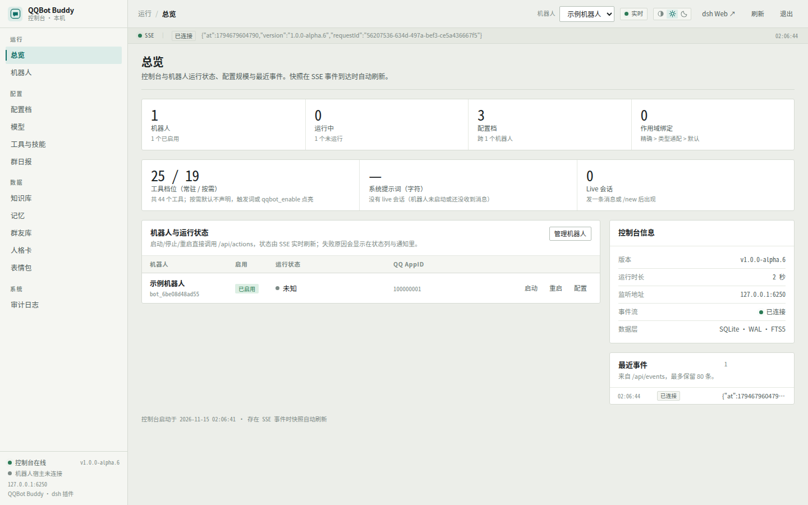

## 配置档

15 个设置分节收敛成 5 个组 tab（对话与人设 / 模型与语音 / 能力与权限 / 记忆与数据 / 群日报），
组内按分节堆叠；作用域绑定在「机器人 → 详情」里做。

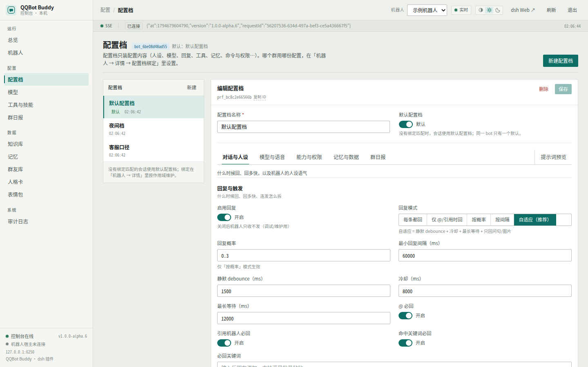

## 提示词预览

按真实顺序看每一段来源、范围与字符数，可复制单个片段或全文。

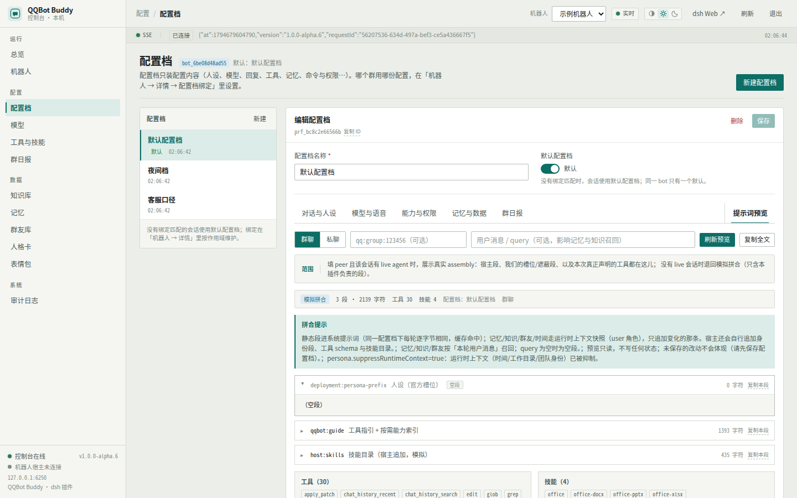

## 工具与技能

宿主发现清单、装配三态（已装载 / 已声明 / 索引中）、常驻 / 按需档位、白名单与黑名单。

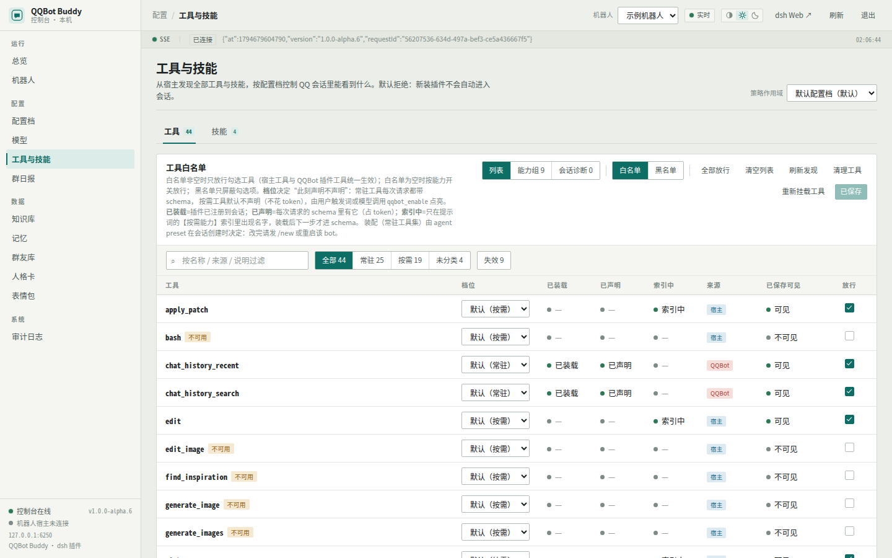

## 模型中心

LLM / 视觉 / 语音（TTS）/ 语音识别（ASR）/ 更多类型插槽；TTS 供应商按默认 / 克隆 / 文字设计分开配置，可试听。

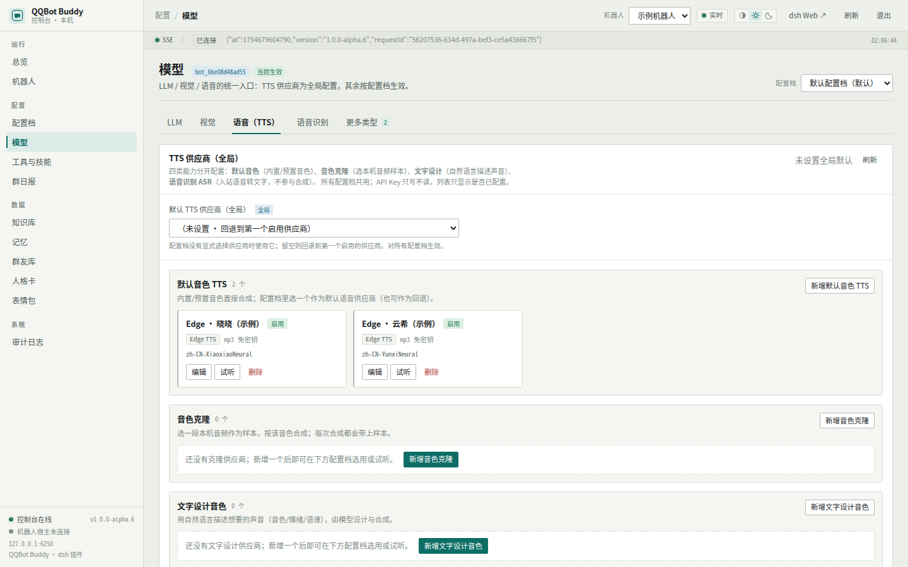

## 群日报模板

左列模板清单（内置 + 自定义），右侧用示例数据真实渲染卡片；可切氛围、放大预览、一键应用与安装模板。
下图用的是随包自带的最简示例模板 `minimal`。

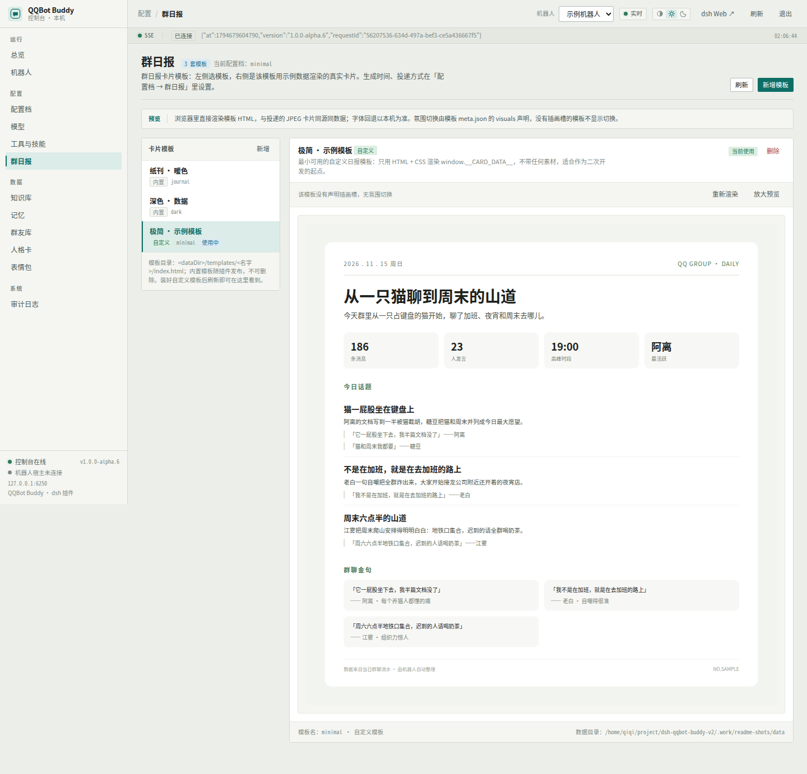

深色主题下的同一页面：

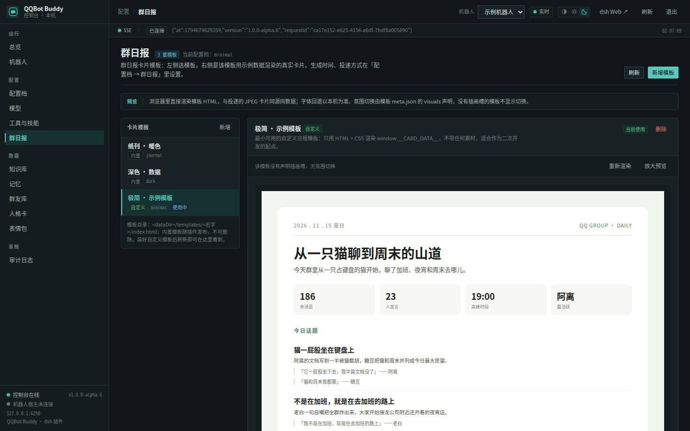

## 记忆与知识库

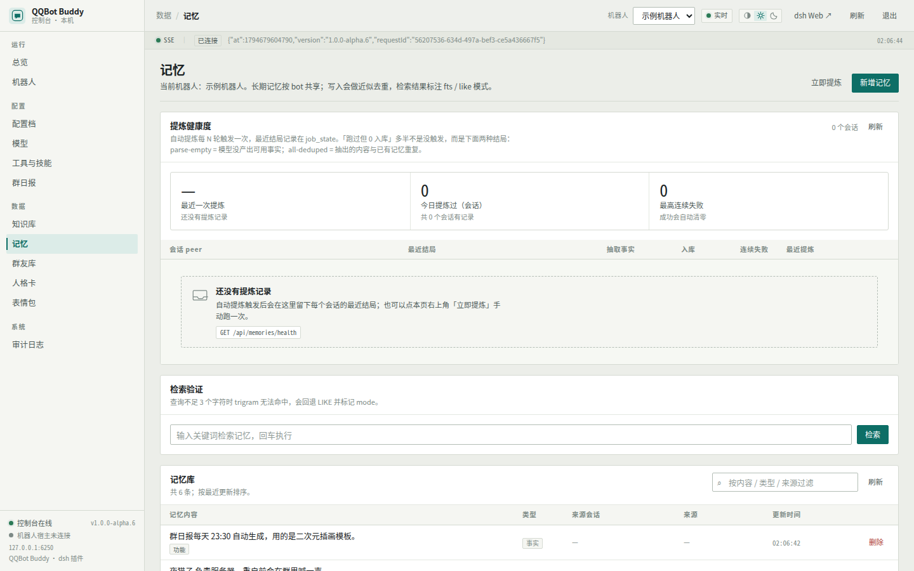

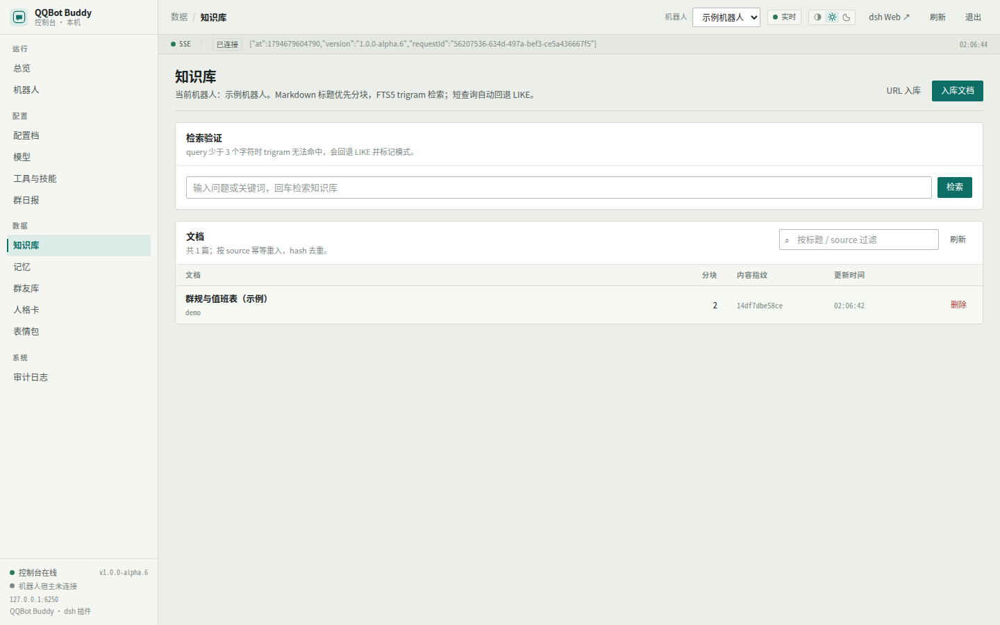

## 深色主题

自动 / 浅色 / 深色三态，登录页与全部页面同步。

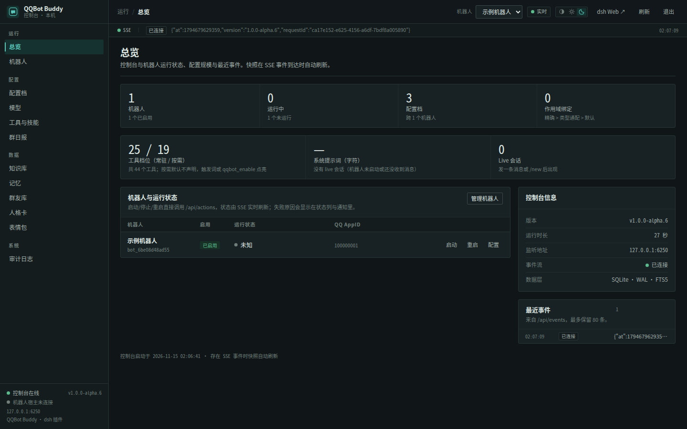

## 与 dsh Web 的互相跳转

dsh Web 会话头部「…」菜单里的「QQBot 大屏」入口：

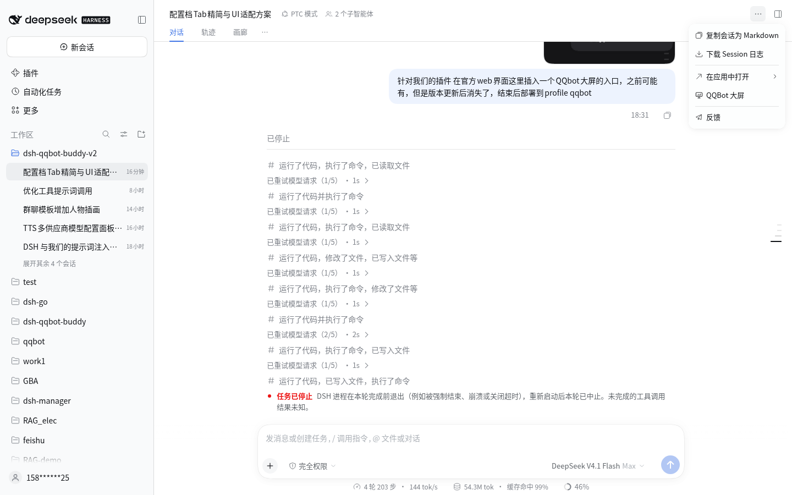
