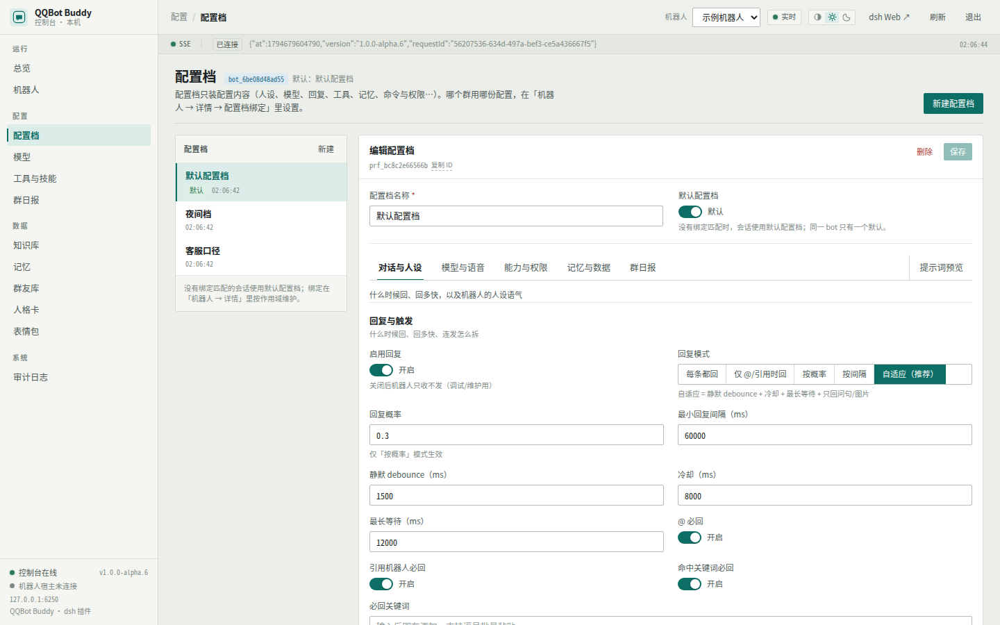
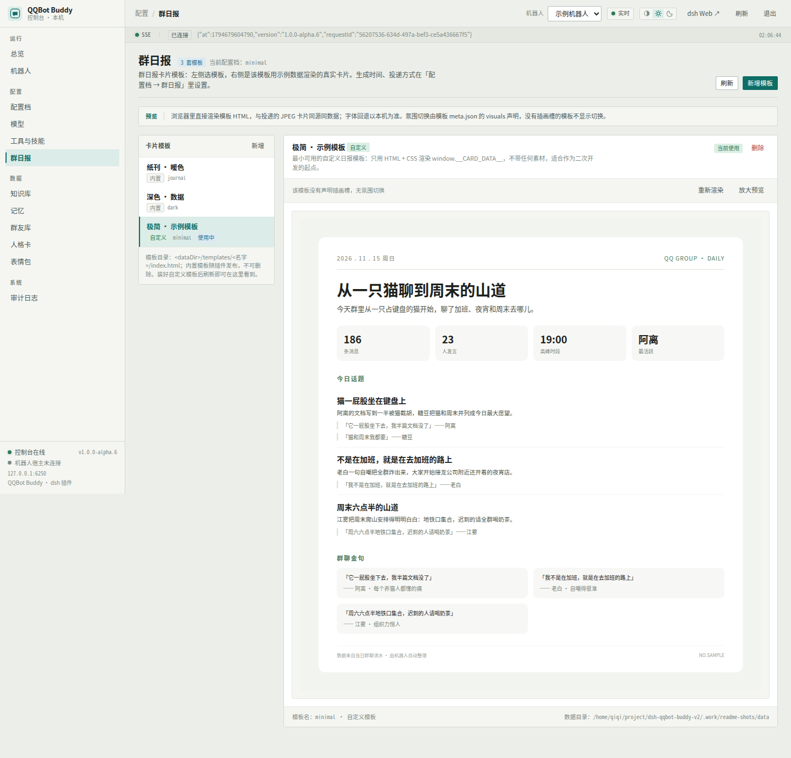
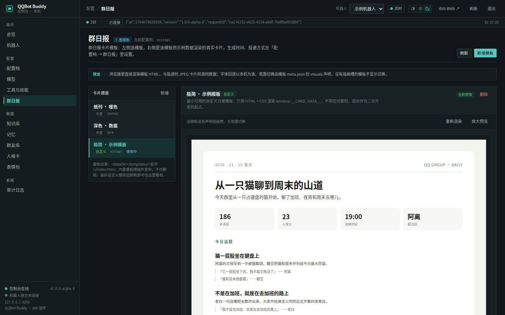
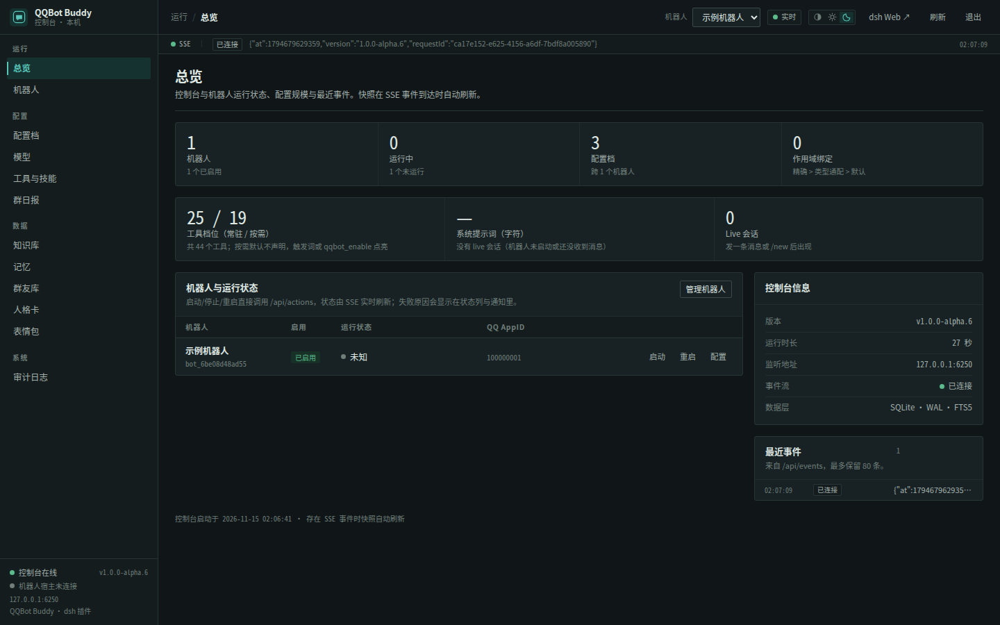

# UI 适配：配置档分组、群日报模板页、深浅主题

> 状态：已实现（本轮 UI 适配）。本文档记录**方案与落点**，便于后续维护与评审。
> 关联代码：`lib/core/config/schema.js`、`web/src/pages/ProfilesPage.tsx`、`web/src/pages/ReportsPage.tsx`、
> `web/src/state/theme.ts`、`lib/console/api/reports.js`、`lib/reports/preview.js`、`lib/reports/sample.js`。

## 0. 三条诉求

1. 配置档下的子 tab 太多，精简合并，要一个方案；
2. 做一个「每日报告（群日报）的模板预览与新增」页面；
3. UI 风格：黑暗模式与正常模式的切换。

## 1. 配置档子 tab：15 个 → 5 组

### 1.1 现状与问题

配置档编辑器顶部的子 tab 由 `GET /api/schema` 的 `sections` 直接平铺而来，共 15 个：
回复与触发、人设与提示、模型、工具与技能、记忆、消息记录、知识库、群友库、视觉、语音（TTS）、
语音识别（ASR）、表情包、群日报、关系增量、命令与权限。

问题：① 数量超过一屏，需横向滚动，常用项被挤到后面；② 平铺没有层级，用户不知道「改群日报」应该去哪个 tab；
③ 未保存计数分散在 15 个 tab 上，扫视成本高；④ 每新增一个设置域就要多一个 tab，会继续膨胀。

### 1.2 方案对比

| 方案 | 做法 | 判断 |
| --- | --- | --- |
| A. 两级分组（采纳） | 分节归并成 5 个「组 tab」；组内按分节纵向堆叠，保留分节标题与说明 | tab 数 15→5，不丢字段粒度；脏计数按组聚合；后续新分节只需挂到已有组，不再加 tab |
| B. 单列长表单 | 去掉 tab，所有分节一屏纵向排列 + 右侧锚点目录 | 页面极长（100+ 字段），滚动与 JS 锚点成本高，移动端更差 |
| C. 左侧竖排目录 | 编辑器内部再套一列侧栏 | 配置档页已有「配置档列表」master 列，再套一层侧栏横向空间不够 |

采纳 A：**组是纯 UI 收敛层，不参与存储与权限**；分节仍是字段粒度的唯一真相，设置项 schema 不变。

### 1.3 五组映射（`GROUPS` / `SECTIONS[].group`）

| 组 tab | 组内分节 | 覆盖内容 |
| --- | --- | --- |
| 对话与人设 | 回复与触发、人设与提示 | 什么时候回、回多快、连发怎么拆；人格/提示段/运行时上下文 |
| 模型与语音 | 模型、视觉、语音（TTS）、语音识别（ASR） | provider/model/推理强度；图片入上下文；TTS 音色；ASR 回退 |
| 能力与权限 | 工具与技能、表情包、命令与权限 | 工具白名单、技能过滤、表情包配额、管理员命令门控 |
| 记忆与数据 | 记忆、消息记录、知识库、群友库 | 采集/召回预算、消息流水保留期、知识检索、群友画像注入 |
| 群日报 | 群日报、关系增量 | 定时生成与投递、卡片模板、按互动调整关系 |

### 1.4 交互细节

- 组 tab 显示**聚合后的未保存计数**（组内所有分节脏条数之和）。
- 组内分节纵向堆叠：分节标题 + 一行说明 + 字段网格；第一条之前不再画分隔线。
- 「提示词预览」仍是独立 tab，固定在 tab 行最右侧。
- 向后兼容：`/api/schema` 没返回 `groups` 时，前端自动回退为「一分节一 tab」（旧后端/旧数据目录不会白屏）。
- 换配置档、放弃修改、保存等既有语义不变；保存仍然只提交差异路径。

### 1.5 代码落点

- `lib/core/config/schema.js`：新增 `GROUPS`，`SECTIONS` 每项加 `group`；`schemaPayload()` 透出 `groups`。
- `lib/console/api/schema.js`：`GET /api/schema` 返回 `{ items, sections, groups }`。
- `web/src/pages/ProfilesPage.tsx`：按 group 聚合 → 两级渲染；无 groups 时回退。
- `web/src/api/types.ts`、`normalize.ts`：`SchemaGroup` 与 `section.group` 的前端契约。

## 2. 群日报模板页（`/reports`，导航「配置 → 群日报」）

### 2.1 为什么需要它

群日报卡片模板此前只能：① 在配置档下拉里选一个名字；② 用 `npm run template:install` 装自定义模板；
③ 想看效果只能真的生成一份日报发到群里。模板长什么样、装没装成功、当前配置档用的是哪套，控制台里看不到。

这个页面把「预览 → 安装 → 选用」闭环搬进控制台：

- **真实预览**：浏览器里直接渲染模板 HTML（同一份模板文件、同一份示例 payload、同一套插画选择逻辑），
  而不是截图或手绘 mock；与投递到 QQ 的 JPEG 卡片同源。
- **氛围切换**：示例数据可切模板声明的氛围，声明了插画槽的模板会跟着换对应槽位的插画。
- **设为当前配置档模板**：等价于写 `activeProfile.data.daily.template`（深合并 PATCH），不用再进配置档页翻设置。
- **新增模板**：选择本地模板目录（index.html + 可选 meta.json + assets/）或粘贴单文件 HTML，
  客户端 base64 编码后提交，服务端校验并写入 `<dataDir>/templates/<名字>/`；装完立即出现在列表里。
- **删除自定义模板**：内置模板受保护，仅允许删 `<dataDir>/templates/` 下的自定义项，二次确认。

页面结构是控制台既有的 master-detail：左侧模板列表（内置/自定义徽标 + 名字），右侧预览舞台 +
模板信息 + 操作。放大预览复用抽屉（Drawer），整张卡片可按比例缩放查看。

### 2.2 后端接口（`lib/console/api/reports.js`）

| 方法/路径 | 作用 | 关键点 |
| --- | --- | --- |
| `GET /api/reports/templates` | 列模板（已有） | 内置 journal/dark + `<dataDir>/templates` 下自定义 |
| `GET /api/reports/templates/preview?name=&mood=&day=&meta=1` | 预览元数据 + 自包含 HTML | 资源内联 data URI；注入 `window.__CARD_DATA__`；注入高度上报 postMessage；`meta=1` 时省略 HTML |
| `GET /api/reports/templates/preview/html?name=&mood=&day=` | 直接返回预览文档（iframe src） | 自带窄 CSP + `X-Frame-Options: SAMEORIGIN`；不被控制台页面的 `script-src 'self'` 继承 |
| `POST /api/reports/templates/install` | 安装/覆盖自定义模板 | base64 文件数组；名字/路径/大小校验；内置名保留；路由级 16MB body 上限 |
| `DELETE /api/reports/templates/:name` | 删除自定义模板 | 只允许删数据目录内模板；内置名拒绝 |

预览 HTML 由 `lib/reports/preview.js` 拼装：`templatePath` 找模板 → `buildHtml`（内联 assets、清空字体占位）
→ 注入示例数据与高度脚本；示例数据来自 `lib/reports/sample.js`（与真实 daily payload 同形状）。

前端用 `sandbox="allow-scripts"` 的 iframe 以 **独立文档 URL**（`/api/reports/templates/preview/html`）渲染，
父页面通过 `{ type: 'qqbot:report-preview', height }` 消息拿内容高度，按容器宽度等比缩放（1200 逻辑宽），窄屏不横向溢出。

> 为什么不用 `srcdoc` + JSON：控制台页面 CSP 是 `script-src 'self'`，`srcdoc` 文档会继承父页 CSP，
> 模板里的内联脚本（`window.__CARD_DATA__` 渲染逻辑与高度上报）会被浏览器直接拦掉（现象：只有静态骨架、数据全空）。
> 独立文档响应给自己的窄 CSP（`default-src 'none'; img-src data:; script-src 'unsafe-inline'`，
> 禁一切网络请求），配合 sandbox 把模板 JS 限制在拿不到 cookie、发不出请求的隔离环境里。
> 首帧 iframe 逻辑高度先给 420px 再量 `scrollHeight`，避免短模板被 1800px 兜底高度撑出空白。

### 2.3 安全边界

- 模板名仍受 `/^[A-Za-z0-9][A-Za-z0-9_-]{0,31}$/` 约束；安装路径 `path.posix.normalize` 后拒绝 `..`/绝对路径/反斜杠。
- 只允许白名单扩展名（html/css/js/json/webp/png/jpg/jpeg/gif/svg/woff/woff2/ttf/otf），单文件 ≤ 8MB、总量 ≤ 16MB。
- 内置模板名（journal/dark/off）保留，不能被自定义模板覆盖，也不能删除。
- 预览 iframe 不授 `allow-same-origin`：模板脚本拿不到控制台 cookie 与 DOM。

## 3. 深浅主题切换

### 3.1 交互

顶栏「实时」状态右侧新增三态图标开关：**跟随系统 / 浅色 / 深色**，选择写入
`localStorage['qqbot.console.theme']`，刷新、重开浏览器都保持；选择「跟随系统」时监听
`prefers-color-scheme` 实时切换。

### 3.2 实现

- `web/index.html`：内联脚本在样式与 JS 包之前读取 localStorage/系统偏好，写入
  `<html data-theme="light|dark">` 与 `data-theme-mode`，**首屏不闪白/不闪黑**。
- `web/src/styles.css`：颜色变量两套——浅色在 `:root`，深色在 `:root[data-theme="dark"]`；
  删除原来的 `@media (prefers-color-scheme: dark)` 单向绑定（改为脚本解析，便于手动覆盖）。
  新增 `--on-danger` 修正深色下危险按钮白字对比度；同步 `color-scheme`，原生控件/滚动条跟随。
- `web/src/state/theme.ts`：`initTheme()` / `setThemeMode()` / `useThemeMode()`；
  `meta name="theme-color"` 随主题更新（移动端状态栏）。
- `web/src/components/ThemeSwitch.tsx` + `Layout.tsx`：顶栏图标分段控件（内联 SVG，无外部字体/图片）。

## 4. 验收

- 后端：`npm test` 全绿（含新增的日报模板控制台接口测试）。
- 前端：`npm --prefix web run typecheck` 通过；`npm --prefix web run build` 产物可直接由控制台静态托管。
- 视觉：演示控制台下按 1440 / 390 两种宽度截图验收——登录、总览（浅/深）、配置档 5 组 tab、
  日报模板页（三套模板 + 氛围切换 + 安装抽屉 + 删除确认）、窄屏单列布局；并断言预览 iframe 真渲染出示例数据、
  主题刷新后保持、5 组 tab 数量、目录上传安装与删除的列表变化。

深色主题下的同一页——控制台外壳与模板卡片各自独立：外壳跟随主题，模板卡片保持它自己的配色（与投递的 JPEG 同源，这是预期行为，不是暗色失效）：

- 回归：旧后端（无 `groups`）时配置档页回退为原有一分节一 tab；无自定义模板时日报页给出空态与安装入口。
