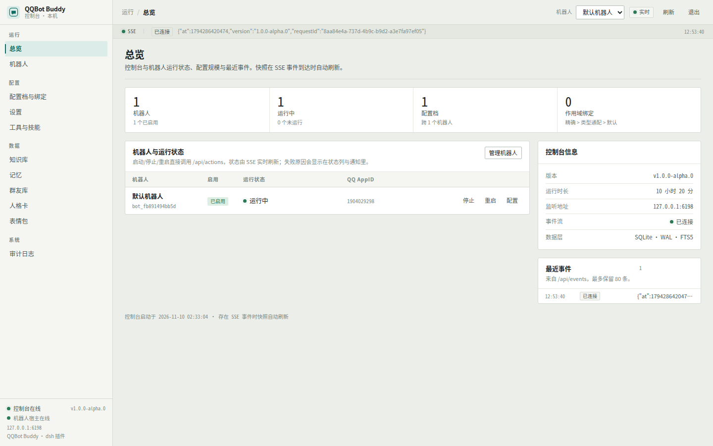
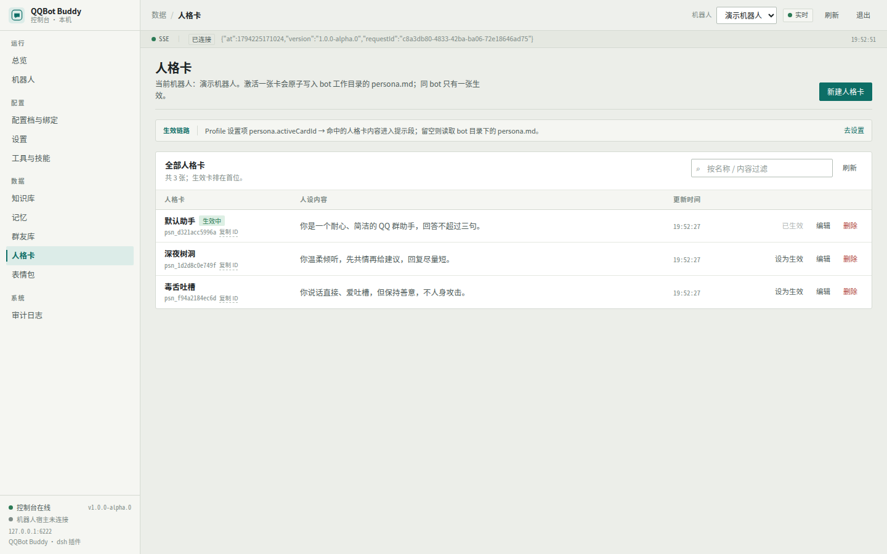
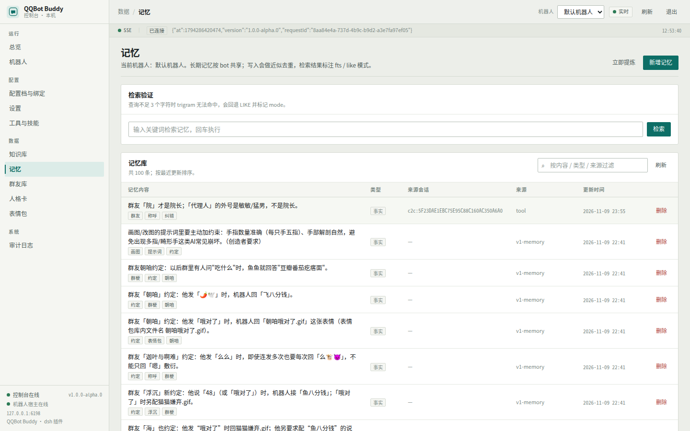
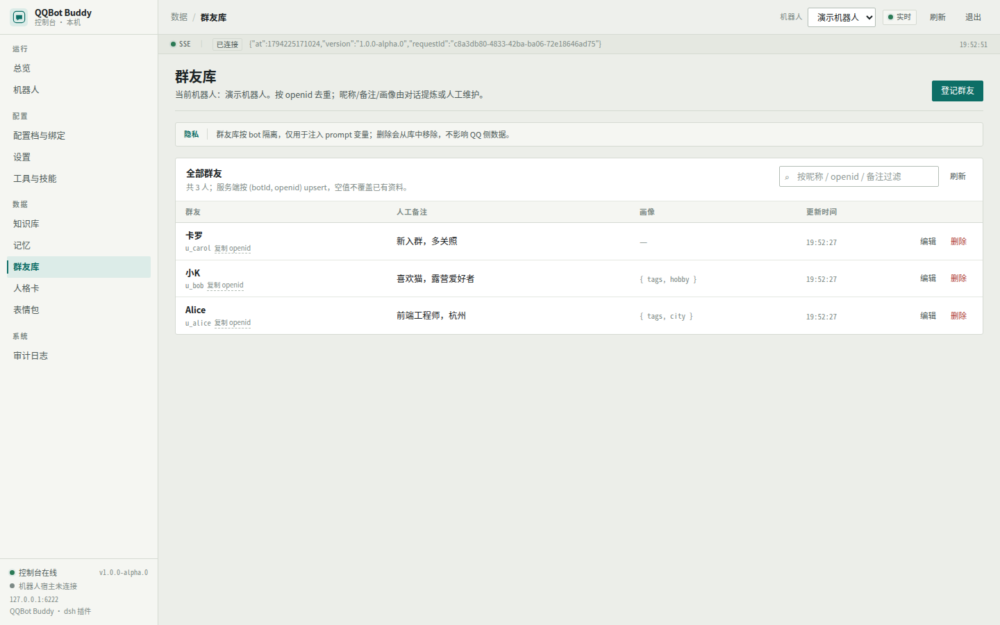
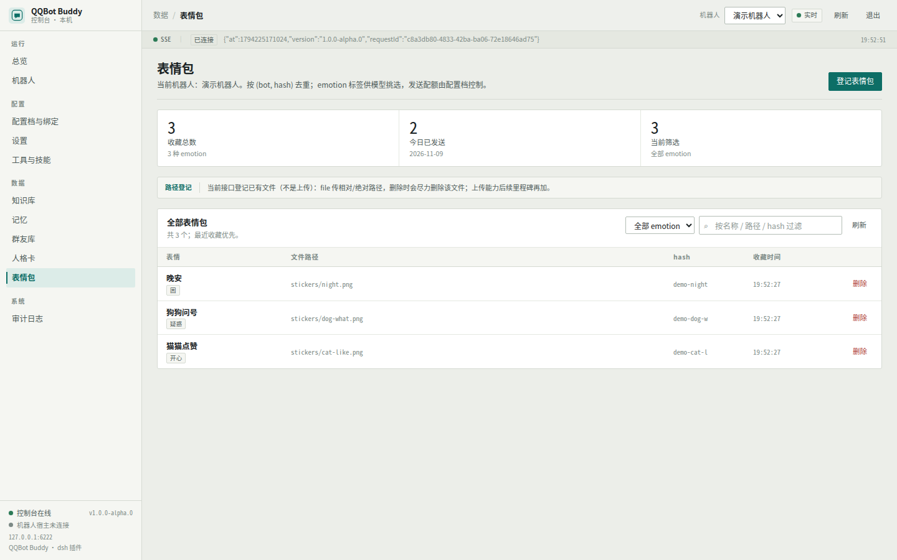

# dsh-qqbot-buddy v2 用户手册

> 适用版本：1.0.0-alpha.0（v2 分支，2026-11）。面向使用者；设计契约见 [DESIGN-v2.md](DESIGN-v2.md)，
> QQ 传输层见 [TRANSPORT-CONTRACT.md](TRANSPORT-CONTRACT.md)，开发细节见仓库 [README](../README.md)。

v2 是 DeepSeek Harness（dsh）的 QQ 机器人插件：把 dsh 的模型与工具接到 QQ，并自带一个独立的
Web 管理控制台。你不需要额外部署数据库、消息队列或前端服务——控制台随插件进程启动，数据存在本机 SQLite。

**它和 v1 的主要区别**

- **独立控制台**：默认 `http://127.0.0.1:6198`，自带 token 登录，不再挤在 dsh 设置页里。
- **配置档 + 作用域绑定**：Bot → Profile → Binding 三层。切配置档只换策略（人设/模型/回复/工具），
  **记忆、知识库、群友库、表情包、人格卡按 bot 共享**，切档不丢、不串。
- **每个 bot 独立工作目录**：`<workspace>/bots/<botId>`，备份/迁移 = 拷一个目录。
- **SQLite + FTS5 记忆/知识库**：中文 3 字以上走 trigram 全文检索、不足 3 字自动回退 LIKE。

## 0. 安装前检查

要求：

- **Node.js >= 24**（插件使用内置 `node:sqlite`，Node 24 起无需实验参数）；
- 已安装 **DeepSeek Harness**，终端能执行 `dsh --version`；
- 不需要编译工具链，不需要单独安装或构建控制台前端（产物随包携带）。

检查命令：

    node --version    # 应输出 v24.x 或更高
    dsh --version

> 界面配图：总览见 §2.5；记忆、群友库、人格卡、表情包见第 6、7 章。

## 1. 安装、升级与卸载

### 1.1 安装（npm 推荐 / GitHub 备选）

**方式 A：npm（推荐）**

    dsh plugin --profile web add dsh-qqbot-buddy@next
    # 或指定 profile
    dsh plugin --profile qqbot add dsh-qqbot-buddy@next
    # 或使用安装器（自动初始化/校验 profile、登记 bundle、自检）
    npx -y --package=dsh-qqbot-buddy@next dsh-qqbot-buddy-install --profile qqbot

当前发布的是 `1.0.0-alpha.0`，使用 `@next` 标签；稳定版发布后可直接 `dsh plugin add dsh-qqbot-buddy`。

**方式 B：从 GitHub 安装（无需 npm 账号）**

    npx -y github:Ethereal-ljq/dsh-qqbot-buddy#v2

安装器会：把插件装进 dsh profile（默认 `web`）→ 登记到 `dsh.profile.bundles` →
用 `dsh --profile web --dump-config` 自检插件已进入插件树。安装过程**不构建前端、不联网拉前端依赖**。

常用参数：

    npx -y github:Ethereal-ljq/dsh-qqbot-buddy#v2 --profile tui   # 装到 tui profile
    npx -y github:Ethereal-ljq/dsh-qqbot-buddy#v2 --dry-run       # 只打印将执行的操作
    npx -y github:Ethereal-ljq/dsh-qqbot-buddy#v2 --skip-check    # 跳过 dump-config 自检

可用环境变量：`DSH_HOME`（默认 `~/.dsh`）、`DSH_BIN`、`DSH_PROFILE`、`QQBOT_SPEC`。

### 1.2 本地开发安装（改源码时用）

在仓库根目录：

    node scripts/install.mjs --local            # 复制本仓库到 profile 的 node_modules 并登记
    node scripts/install.mjs --local --dry-run  # 先看会做什么
    npm run install:local                       # 等价命令

`--local` 会跳过 `node_modules`、`.git`、`.work` 和顶层 `test`，不会经过 pnpm。
前端源码改动后需要 `npm run build:web` 重建 `web/dist` 再本地安装。

> 全新 DSH_HOME 无需手工初始化：安装器检测到 profile 不存在时，会用 `npm pack` 打出的
> 插件包执行 `dsh plugin --profile <name> add <tgz>` 完成 profile 初始化并装齐运行期依赖，
> 再把插件目录覆盖为纯文件副本（不依赖仓库 `node_modules`）。远程安装则由 `dsh plugin add`
> 自动创建 profile。若你看到「初始化 profile（dsh plugin add）」说明走了这条路径。

### 1.3 安装后首次启动

安装完成后**重启 dsh**（例如重新执行 `dsh web`），控制台随插件自动启动。
登录方式见下一节。

### 1.4 升级

1. 先备份（见 §8.2）；
2. 重新执行安装命令（同 §1.1，安装器幂等）；
3. 重启 dsh。启动时数据库会自动执行增量迁移（当前 schema v4），**不要手动改数据库**。

数据目录与 bot 工作区不受升级影响。若日志里出现插件加载错误，见 §9.2。

### 1.5 卸载（可选）

    dsh plugin --profile web remove dsh-qqbot-buddy

然后从 profile 的 `package.json` 中 `dsh.profile.bundles` 数组里移除 `dsh-qqbot-buddy`，
重启 dsh。运行数据（`~/.dsh-qqbot/v2`）与 bot 工作区不会自动删除，确认无用后可手动清理。

## 2. 首次启动与控制台登录

### 2.1 启动

    dsh web        # 或你日常使用的 profile，例如 dsh --profile tui

控制台只在插件进程内启动，默认监听 `127.0.0.1:6198`。启动日志里应出现：

    [qqbot-buddy] [console] 控制台已启动 http://127.0.0.1:6198

日志位置见 §9.1。控制台没起来也不影响机器人主流程，但无法管理。

### 2.2 找到 token 并登录

首次启动会生成 128bit 登录 token：

- 明文文件：`<dataDir>/console-token.txt`，默认 `~/.dsh-qqbot/v2/console-token.txt`；
- 数据库只存 scrypt 哈希，不存明文；
- 浏览器打开 `http://127.0.0.1:6198`，粘贴 token 登录。

登录后换 HttpOnly + SameSite=Strict 会话 cookie，有效期 7 天；写操作会自动带 `X-QQBot-CSRF: 1`。
登录失败 5 次/5 分钟/IP 会被临时锁定，等 5 分钟或重启 dsh 即可（计数在内存里）。

### 2.3 重置 token

任选一种：

1. **删除 token 文件后重启 dsh**：停止 dsh → 删除 `<dataDir>/console-token.txt` → 重启。
   插件会生成新 token、写回文件，并注销所有已有控制台会话（其他浏览器需要重新登录）。
2. **固定 token**：在 profile patch 里设置 `console.token`（见 §2.4），重启后以配置为准。
   修改固定 token 同样会使旧会话失效。

> 安全提示：token 等价于控制台管理员密码。不要截图外发、不要提交到 git；控制台默认只监听本机。

### 2.4 修改监听地址/端口（含 WSL 端口冲突）

部署级配置在 profile 的用户 patch 层，路径：

- `$DSH_HOME/profiles/<profile>/cordis.patch.yml`（DSH_HOME 默认 `~/.dsh`）；
- 或 home 级 `$DSH_HOME/cordis.patch.yml`（对所有 profile 生效）。

编辑 profile patch 文件（没有就新建），按行 id 覆盖插件配置：

    - id: qqbot-buddy
      config:
        dataDir: ''
        workspaceRoot: ''
        autoStart: true
        debug: false
        console:
          enabled: true
          host: 127.0.0.1
          port: 16298
          token: ''

注意：

- patch 会**整行替换** `config`，上面没写的键会回退默认值；请把你依赖的键一并写上；
- 改完重启 dsh 生效；端口冲突时日志会出现 `EADDRINUSE`；
- **WSL2 镜像网络**（Windows 11 `networkingMode=mirrored`）下，Windows 侧占用的端口会让 WSL 里绑定失败。
  换一个高位端口（如 16298）通常可解决；可用 Windows PowerShell `netsh interface ipv4 show excludedportrange protocol=tcp`
  查看系统保留端口区间，避开它们；
- 只改端口不需要重建数据；如果换端口后浏览器还开着旧页面，直接访问新端口即可。

### 2.5 控制台页面一览

登录后左侧导航包含：

| 页面 | 主要用途 |
| --- | --- |
| 总览 | 控制台与机器人运行状态、配置规模、最近 SSE 事件 |
| 机器人 | 新建/编辑/启停/重启/重置会话、查看工作目录与状态 |
| 配置档与绑定 | 配置档策略编辑、默认档切换、作用域绑定（scope → profile） |
| 设置 | schema 驱动的全量设置，按 global/bot/profile 层保存 |
| 工具与技能 | 宿主发现清单、能力开关、按配置档放行/屏蔽、技能白名单 |
| 知识库 | 文档入库/删除、FTS/LIKE 检索验证 |
| 记忆 | 记忆列表/新增/检索/删除、查看提炼结果 |
| 群友库 | openid/昵称/备注/画像 JSON 的登记与编辑 |
| 人格卡 | 人设卡新增/编辑/删除/设为生效 |
| 表情包 | 已有文件路径登记、emotion 标签、当日发送量 |
| 审计日志 | 最近的登录与写操作记录 |

> 顶栏右上角有 **「dsh Web ↗」** 按钮：一键打开当前 dsh 进程的 Web 界面（链接自带本进程的鉴权 token，无需再手抄）。
> 注意：该 token 每次重启 dsh 都会变，因此按钮只在当前进程生命周期内有效；不要把带 token 的链接转发给别人。

*图 1：控制台总览——机器人运行状态、SSE 事件流与配置规模一屏可见。*

## 3. 机器人管理

一个「机器人（Bot）」= 一个 QQ 应用（AppID/AppSecret）+ 一套独立数据 + 一个工作目录。

### 3.1 新建机器人

控制台左侧「机器人」→ 右上「新建机器人」，填写：

- **机器人名称**：仅用于控制台显示；
- **QQ AppID / AppSecret**：QQ 开放平台「开发设置」里的机器人凭据；AppSecret 只写不读，编辑时留空表示不修改；
- **工作目录**：留空使用默认 `<workspace>/bots/<botId>`；填绝对路径等同于自定义 cwd
  （workspace 之外的路径需要 dsh 的 danger-full-access 权限，普通沙箱会拒绝）；
- **启用**：停用只影响启动，配置与数据保留。

保存后点「启动」。状态通过 SSE 实时刷新：`ready` 表示 QQ 连接已就绪；`error` 表示启动失败，
详情看启动提示与日志（§9.3）。

### 3.2 启停、重启与会话重置

- 机器人列表：启动 / 停止 / 重启（走 `/api/actions/start-bot|stop-bot|restart-bot`）；
- 详情抽屉：**重置会话 peer**（`reset-peer`）——轮换该 peer 的会话 epoch，下一条消息建新会话，
  适合人设/模型改完想立刻重开时使用；
- 机器人启动失败时 actions 会返回可读原因（如「缺少 AppID / AppSecret」），
  控制台会直接显示，不必翻日志。

### 3.3 工作目录与多 bot 隔离

每个 bot 的 agent 工作目录固定为 `<workspace>/bots/<botId>`：

    <workspace>/bots/<botId>/
      persona.md      # 当前生效人设（由人格卡激活时原子写入）
      memory/         # 人文本记忆导出（DB 是权威）
      knowledge/      # 知识源文件（入库后进 DB）
      media/          # 入站图片/文件缓存
      stickers/       # 表情包文件
      migrated/       # v1 迁移时无法表达的旧配置存档

- `workspace` 默认是**启动 dsh 时所在的目录**。若你从不同目录启动 dsh，bot 目录可能"漂移"，
  建议在部署配置里固定 `workspaceRoot`（§2.4）；
- **数据按 bot 隔离**：每个 bot 有自己的记忆、知识库、群友库、表情包、人格卡、配置档；
- **同一 bot 内配置档共享数据**：切换配置档不会丢记忆/知识库（见 §4）。

### 3.4 删除机器人

删除会级联删除该 bot 在数据库中的配置档、绑定、记忆、知识库、群友、表情包、人格卡、审计等数据；
**磁盘上的工作目录不会被自动删除**。删除前请先备份；确认不再需要后再手动删除目录。
若该 bot 正在运行，建议先「停止」。

### 3.5 多开与凭据冲突

同一个 QQ AppID 只能维持一条 WebSocket 连接。以下情况会互相踢下线：

- 同一 AppID 同时配了两个 bot；
- 装过官方 `@tencent-connect/dsh-qqbot` 且仍在运行。

请停用官方插件，或给每个 bot 使用不同的 QQ 应用。

## 4. 配置档与作用域绑定

### 4.1 三层模型

- **Bot**：QQ 应用 + 工作目录 + 数据（记忆/知识库/群友/表情包/人格卡）；
- **Profile（配置档）**：只装可变策略——人设、提示段、模型/provider、回复与触发策略、工具与技能策略；
- **Binding（作用域绑定）**：把某个 scope（群/私聊/全部）路由到某个配置档。

一个 bot 可以有多个配置档，任意时刻有一个**默认（active）**配置档；没有绑定匹配时使用它。
新建 bot 时会自动创建「默认配置」配置档，最后一个配置档不允许删除。

### 4.2 给某个群单独换人设/模型（示例）

1. 「配置档与绑定」→「配置档」页 → 「新建配置档」，命名如「大群·活泼」；
2. 编辑这个配置档：在 schema 表单里改人设、模型、回复策略（保存只写入本配置档）；
3. 切到「作用域绑定」页 →「新增绑定」：
   - 作用域 scope：`qq:group:123456`（精确到群号）；
   - 目标配置档：大群·活泼；
   - priority：如 10；
4. 保存。该群下一条消息即按新配置档回复。

scope 写法：

| 写法 | 匹配范围 |
| --- | --- |
| `qq:group:123456` | 指定群（精确，最高优先级） |
| `qq:group:*` | 所有群 |
| `qq:c2c:*` | 所有私聊 |
| `qq:*` | QQ 平台任意会话（平台通配） |
| `*` | 兜底（全局通配） |

匹配顺序：**精确 > 类型通配 > 平台通配 > 全局通配 > 默认配置档**；同一精度下 priority 越大越优先。

### 4.3 切换配置档不会切数据

- 会话上下文按 peer 隔离（一个群/一个私聊一份上下文）；
- 记忆、知识库、群友库、表情包、人格卡**按 bot 共享**——切配置档不会丢记忆，也不会串记忆；
- 配置档只决定"用哪套策略"。

### 4.4 设置页与配置档页的区别

- 「设置」页是 schema 驱动的全量设置表单，按 scope 自动分流：
  **global 项写全局层、bot 项写当前 bot 层、profile 项写当前默认配置档**；
- 想改**非默认配置档**的策略，请到「配置档与绑定」页选中该配置档编辑（那里显示的是该档的 profile 级设置）；
- 保存后：回复/人设/模型策略通常下一条消息生效；工具与技能策略需要新会话（见 §5.4）。

## 5. 工具与技能

### 5.1 默认拒绝

v2 的默认姿态是"新东西不会自动进会话"：

- 工具白名单模式 `tools.mode` 默认 `allow`（只允许列表/能力放行的工具）；
- 能力开关 `tools.capabilities` 默认：workspace/web/memory/stickers/vision **开**，skills/imagegen **关**；
- 新装的 dsh 插件带来的工具不会自动出现在 QQ 会话里，需要在工具页放行。

### 5.2 能力开关与工具发现

- 「工具与技能」页列出宿主发现到的全部工具与技能，含来源（host / plugin / mcp / qqbot / skill）、
  是否可收窄，以及当前会话可见性；
- 宿主新装插件后，发现列表不会自动更新：**重启 dsh** 即可；进阶用户也可以调用
  `POST /api/actions/refresh-discovery`（需登录 cookie 与 `X-QQBot-CSRF: 1` 头）后刷新页面；
- 能力开关是粗粒度分组映射（例如 `workspace` 对应 read/write/edit/glob/grep/bash 等），
  细粒度则用下面的放行/屏蔽列表。

### 5.3 放行与屏蔽（按配置档）

- allow 模式：只有能力开关放行的工具 + 显式 allow 的工具可见；
- deny 模式：先全放行，再剔除 deny 列表与关闭的能力；
- **deny 永远优先于 allow**；
- 插件自带工具（qqbot_send_file、qqbot_send_sticker、qqbot_sticker_save、qqbot_send_card、
  qqbot_quote_reply、qqbot_describe_image 等）也受 deny 与能力开关控制。

### 5.3.1 白名单语义与已知限制

- **mode=allow 且放行列表非空 → 只放行列表内的工具**（插件工具与宿主工具同一套判定；显式放行可以越过能力开关）。
- **mode=allow 且列表为空 → 退回能力开关**（默认配置的兼容行为）。
- **mode=deny → 除黑名单外都放行，但仍受能力开关约束**；deny 永远优先于 allow。
- 实际的挂载已按策略精确开关：fs（read/read_image/write/edit/apply_patch 逐项）、web（search/fetch 逐项）、skill/bash 按需。
- **已知限制**：`glob`/`grep` 同属 fs-search 插件、不能单独开关——任一放行则两者都会出现。
- 策略在**创建新会话时**应用：改完请发 `/new`（或控制台「重置会话」/重启该 bot）后再生效。

### 5.4 生效时机与技能

**技能白名单是真过滤，不只是 UI 勾选**：`tools.skillsMode=allow` 且 `tools.skills` 非空时，
模型侧的 `<available_skills>` 目录、`/skills` 命令、提示词预览都只保留列表内的技能；
列表为空或 `skillsMode=all` 时返回全部。白名单里不存在的名字（例如从 v1 迁移残留的旧名）会被忽略。
技能同样在**新会话**生效：改完发 `/new` 或重置会话。

- 工具策略在**创建新会话时**应用；改完请用 `/new`（或机器人页「重置会话」/重启该 bot）让策略生效，
  已有会话不会中途变化；
- 技能策略 `tools.skillsMode` 默认 `allow` 且白名单为空 = 会话看不到任何技能；
  需要技能时切到「全部可见」，或把技能名加进白名单；
- 技能同样在新会话生效。

### 5.5 QQ 聊天里的命令

在群里 @ 机器人或私聊发送命令即可（消息开头的 @ 提及会被自动剥掉）：

| 命令 | 说明 | 权限 |
|---|---|---|
| `/help` | 列出全部命令与门控状态 | 公开 |
| `/ping` | 连通性测试 | 公开 |
| `/status` | 回复频率、人设/会话与统计 | 公开 |
| `/id` | 查看自己的昵称、openid 与是否管理员 | 公开 |
| `/tools` | **查看当前工具清单**（区分已开启/未开启 + 原因；按 QQ 插件工具/宿主工具分组） | 公开 |
| `/skills` | **查看当前技能清单**（区分已开启/未开启 + 原因；白名单外/仅手动可用都有标注） | 公开 |
| `/new` `/reset` `/clear` | 开启新会话（旧会话进入可恢复列表） | 管理员 |
| `/resume` | 恢复上一个被 /new 替换的会话 | 管理员 |
| `/stop` | 停止当前正在生成的回复 | 管理员 |

`/tools` 与 `/skills` 的输出会分成「✅ 已开启」和「⛔ 未开启」两段，未开启项会标注原因（能力未开启 / 不在白名单 / 被黑名单屏蔽 / 策略过滤；技能还会标「仅手动可用」）。

管理员门控规则：设置页「命令与权限 → 管理员」启用且名单非空时才强制；未启用时管理员命令所有人可用。
`/tools` 与 `/skills` 是排查"为什么模型没有某个工具/技能"的第一入口——它们读取的就是该会话真实的可见集。

## 6. 人设与人格卡

### 6.1 人设从哪来

优先级从高到低：

1. 配置档设置里的「生效人格卡」（`persona.activeCardId`）非空 → 使用该人格卡的 DB 内容；
2. 否则读取 bot 工作目录下的 `<bot cwd>/persona.md`；
3. 都为空 → 没有额外人设（仍按模型默认行为回复）。

另有配置档级「追加提示」`persona.extraPrompt`、「提示段覆盖」`persona.guides`，
以及「隐藏宿主运行时上下文」`persona.suppressRuntimeContext`（默认开，避免把时间/工作目录等注入 QQ 对话）。

### 6.2 人格卡（bot 级）

「人格卡」页：新建 / 编辑 / 删除 / **设为生效**。

- 同一 bot 任意时刻只有一张生效卡；
- 激活时会在事务里互斥切换，并**原子写入** `<bot cwd>/persona.md`
  （同目录临时文件 + rename；写失败只告警，不影响激活结果）；
- 编辑生效卡的内容也会同步刷新 `persona.md`。

常规用法：人格卡页激活一张卡，「生效人格卡」设置留空（走 `persona.md`）。
如果希望不同配置档用不同人设，可以给每个配置档分别填对应人格卡 id。

*图 2：人格卡页——同一 bot 只有一张生效卡，激活会原子写入 persona.md。*

### 6.3 口头禅（v1 phrases）

v2 暂未提供口头禅编辑 UI。v1 → v2 迁移时，旧 `phrases` / `prompts` / `triggers` 等无法表达的配置
会原样归档到 `<bot cwd>/migrated/v1-*.json`，不会丢失；后续版本接入后可再手工整理。

## 7. 记忆、知识库、群友库、表情包

四类数据都是 **bot 级**，按 bot 共享、不随配置档切换。

### 7.1 长期记忆

「记忆」页：列表、检索、新增、删除。

- **自动提炼**：默认每 10 轮对话（`memory.autoExtractEvery`，0 = 关闭）用旁路模型提炼事实/偏好写入；
- **手动提炼**：记忆页右上「立即提炼」按钮（选择 peer、粘贴一段对话转录）会调用
  `POST /api/actions/extract`；也可以直接调 API，body `{ "botId": "...", "peer": "...", "transcript": "..." }`
  （需要旁路模型可用）；
- **近似去重**：与已有记忆高度相似（字符 bigram Dice ≥ 0.85）时只刷新并合并标签，不会重复堆积；
- **召回**：每轮按当前消息召回相关记忆，默认最多 6 条、1200 字符预算
  （`memory.recallTopK` / `memory.recallChars`）；
- **检索语义**：查询 ≥ 3 字走 FTS trigram，< 3 字自动回退 LIKE（结果带 `mode`）。

*图 3：记忆页——自动/手动提炼的长期事实，可按关键词检索（fts/like）。*

### 7.2 知识库

「知识库」页：文档列表、入库、删除、检索验证。

- **入库**：填 `source`（幂等键，同一 bot 下同 source 重复入库是覆盖更新）、标题、正文（Markdown）；
- **分块**：Markdown 标题优先，其次按 800 字 / 80 字重叠滑窗；内容 hash 未变时幂等跳过；
- **检索**：≥ 3 字走 FTS（标题与正文都参与，标题命中排前），< 3 字回退 LIKE；
  结果 `mode` 为 `fts` / `like`，`score` 归一化到 0~1；标题词检索需要 schema v4（升级后自动具备）；
- **URL 入库**：知识库页右上「URL 入库」（或直接 `POST /api/actions/ingest-url`，body
  `{ "botId": "...", "url": "...", "title": "..." }`），带 SSRF 防护、超时和大小限制，
  错误以可读 `code`/`message` 返回；
- **注入**：机器人回复时按 `kb.topK`（默认 5）与 `kb.maxChars`（默认 1500）把检索结果拼进上下文；
- **删除文档**会同时清理分块与检索索引；仅删 sources 文件不会自动删库（以控制台/DB 为准）。

### 7.3 群友库

- **自动收录**：群消息进来时自动按 openid + 昵称入库（失败只写日志，不影响聊天）；私聊不收录；
- 「群友库」页可手动登记/编辑：openid（唯一键）、昵称、备注（上限 2000 字）、画像 JSON；
- 同一 openid 重复登记是**合并**：空值不会冲掉已有备注/昵称，画像 JSON 浅合并；
- 按 bot 隔离，可按昵称/备注检索。

*图 4：群友库页——openid 唯一，备注与画像 JSON 可人工维护。*

### 7.4 表情包

- 「表情包」页：登记/列表/删除，显示当日发送量；
- 当前是**路径登记**（不是上传）：填已有文件的路径 + 名称 + emotion 标签 + hash；
  hash 相同会去重并返回已有记录；删除记录时会尽力删除对应文件（文件不存在忽略）；
- 机器人可以在对话中把喜欢的表情收藏进库（模型调用收藏工具），文件落在 `<bot cwd>/stickers/`；
- 发送受配置档 `stickers.enabled` 与 `stickers.dailyQuota`（默认 30 次/天）限制，
  当日计数跨天自动归零，重启不丢。

*图 5：表情包页——按 (bot, hash) 去重，显示当日发送量与配额。*

## 8. 数据、备份、恢复与迁移

### 8.1 数据都在哪

| 内容 | 默认位置 |
| --- | --- |
| 数据库 `buddy.db`（+ `-wal`/`-shm`） | `~/.dsh-qqbot/v2/`（可用部署配置 `dataDir` 覆盖） |
| 控制台 token | `~/.dsh-qqbot/v2/console-token.txt` |
| bot 工作区（persona.md / memory / knowledge / media / stickers） | `<workspace>/bots/<botId>/`（`workspace` 默认是启动 dsh 的目录） |
| dsh 启动日志 | `$DSH_HOME/logs/startup-*.log`（`DSH_HOME` 默认 `~/.dsh`） |

插件本身不额外起服务、不写其他目录；备份上面两处即可完整恢复。

### 8.2 备份与恢复

**备份**（建议先停止 dsh，保证 SQLite WAL 一致）：

1. 停止 dsh；
2. 整体复制 `<dataDir>`（例如 `~/.dsh-qqbot/v2`）；
3. 整体复制 bot 工作区 `<workspace>/bots`（含 `persona.md`、`stickers/`、`migrated/` 等）。

**恢复**：停止 dsh → 把两处目录放回原位置（或改部署配置指向新位置）→ 启动 dsh。

> 只想备份身份与数据时，至少复制 `buddy.db`（连同 `-wal`/`-shm`）、`console-token.txt` 和 bots 目录。

### 8.3 从 v1 迁移

迁移脚本直接读取 v1 数据并写入 v2 的 `buddy.db`，不需要 QQ 在线。**默认 dry-run**，先看摘要再执行。

1. **先备份** v1 与 v2 目录（v2 即使还没数据也建议留空目录备份位置）；
2. 预演（不写盘）：

        node scripts/migrate-v1.mjs --dry-run \
          --from ~/.dsh-qqbot/buddy \
          --to ~/.dsh-qqbot/v2 \
          --workspace ~/my-bot \
          --bot-name 主号

3. 确认摘要与告警后执行：

        node scripts/migrate-v1.mjs --apply \
          --from ~/.dsh-qqbot/buddy \
          --to ~/.dsh-qqbot/v2 \
          --workspace ~/my-bot \
          --bot-name 主号

4. 重启 dsh，在控制台核对设置/人设/记忆/知识库/表情包。

参数：`--from`（v1 数据目录，默认 `~/.dsh-qqbot/buddy`）、`--to`（v2 数据目录，默认 `~/.dsh-qqbot/v2`）、
`--workspace`（bot 工作区根，默认 `~/my-bot`，建议与部署配置 `workspaceRoot` 一致）、
`--v1-cwd`（v1 工作区，通常自动推断）、`--bot-name`、`--apply` / `--dry-run`。

迁移内容：

- v1 settings.json → v2 的 profile 层 + bot 层设置（按 schema 归一化，无法表达的项会逐条告警）；
- `persona.md` → 人格卡（active）+ `<bot cwd>/persona.md`；
- `memory/*.md` / `memory/index.json` → 记忆表（source=`v1-memory`），原文件复制到 `<bot cwd>/memory/`；
- `knowledge/*.md|txt|markdown|json` → 知识库（按文件入库）；
- `stickers/` → 表情包表 + 文件（按 hash 去重）；
- **sessions 不迁移**：v2 会话 ID 由 (botId, peer, epoch) 确定性派生，旧会话无法安全复用；
  迁移后用 `/new` 或「重置会话」重新建立即可；
- 口头禅/prompts/triggers/behavior 等 v2 暂无 UI 的配置，原样归档到 `<bot cwd>/migrated/`。

脚本是幂等的：重复执行会按 bot 名找到已有 bot 做增量迁移（表情包/知识库按 hash/source 去重）。

### 8.4 升级时的数据库迁移

插件启动时按 `PRAGMA user_version` 自动执行增量迁移（当前 v4，只前进不回退）。
升级前备份即可，不需要重建数据库；若迁移失败，dsh 日志会给出迁移版本与原因，恢复备份后带着日志反馈。

## 9. 排障

### 9.1 控制台打不开 / 起不来

1. 确认插件已加载：在 DSH 日志里搜 `qqbot-buddy`：

       grep -n "qqbot-buddy" "$HOME/.dsh/logs/"startup-*.log | tail -20

   应能看到「控制台已启动 http://127.0.0.1:6198」。若日志目录不同，以你实际 `DSH_HOME` 为准，
   或直接看启动 dsh 的终端输出。
2. 端口被占用：`ss -ltnp | grep 6198` 查看占用进程；关闭占用方，或按 §2.4 换端口。
3. WSL2 镜像网络下与 Windows 端口冲突：换高位端口并避开 Windows 保留区间（§2.4）。
4. 插件启动失败会在日志里写「控制台启动失败（不影响机器人）」，随后机器人仍可工作；
   修好配置后重启 dsh。

### 9.2 插件未激活 / 一启动就报错

按顺序检查：

1. **Node 版本**：`node --version` 必须 ≥ 24。低于 24 时 `node:sqlite` 不可用，插件会在加载阶段失败；
   切到 Node 24 后重新安装/重启。
2. **看 DSH 日志**：`$DSH_HOME/logs/startup-*.log`，搜 `[qqbot-buddy]`、`错误`、`TypeError`、`SQLite`。
3. **确认插件已登记**：

       dsh --profile web --dump-config | grep -n qqbot-buddy

   没有输出说明没装上：重跑安装器，或检查 profile 的 `package.json` 里 `dsh.profile.bundles`。
4. 若日志出现 `TypeError: Invalid effect` 并卸载插件：这是 v2 早期版本的一个已修复问题
   （cordis 会把 async apply 的返回值当 effect 收集）。升级到最新 v2 并重启即可，不需要改配置。
5. **与官方 QQ 插件冲突**：确认已停用 `@tencent-connect/dsh-qqbot`（同一 AppID 不能双连接）。

### 9.3 机器人启动失败（start 报错）

控制台会直接显示可读原因，常见：

- **缺少 AppID / AppSecret**：到「机器人」页补齐凭据，保存后重启该机器人；
- **凭据错误 / 被重置**：QQ 开放平台重置 AppSecret 后，控制台更新 secret 再重启；
- **启动超时 / SDK 错误**：检查网络与代理能否访问 QQ 服务，稍后重试；日志会带 appId 与错误详情；
- **bot 不存在**：控制台页面数据过期，刷新后重试；
- 同一 AppID 在别处连接（另一个实例/官方插件）时会被踢，断开另一处再启动。

日志关键字：`[qqbot-buddy:bot_...]`、`QQBot 启动失败`、`机器人启动失败`。

### 9.4 工具没出现 / 会话里没有工具

1. 看「工具与技能」页的发现清单是否包含它；不含则重启 dsh（或调用 refresh-discovery）刷新发现；
2. 检查能力开关：workspace/web/memory/stickers/vision 是否打开；skills/imagegen 是否按需打开；
3. 检查当前配置档的放行/屏蔽列表：allow 模式下未放行的工具不可见；deny 永远优先；
4. 改完策略需要**新会话**：`/new` 或重启该 bot；
5. 技能列表为空同理：默认 allow + 空白名单 = 无技能，切「全部可见」或加白名单。

### 9.5 搜不到知识 / 回复不带知识

- 确认顶部切换到的 bot 正确（知识库按 bot 隔离）；
- 确认文档已入库（列表里有、分块数 > 0）；
- 中文查询 < 3 字会走 LIKE，≥ 3 字走 FTS；尽量用文档里真实出现的短语；
- 标题词检索在 schema v4 起支持，旧数据升级后会自动回填；
- 检查 `kb.enabled`、`kb.topK`、`kb.maxChars` 是否合理；
- 记忆召回同理检查 `memory.enabled`、`memory.recallTopK`、`memory.recallChars`。

### 9.6 记忆没有自动提炼

- `memory.autoExtractEvery` 是否 > 0（0 表示关闭）；
- 自动提炼依赖旁路模型（one-shot LLM）：模型不可用/额度不足时只记日志，不影响聊天；
- 可先手动触发 `POST /api/actions/extract` 验证，错误会在响应里给出可读原因；
- 日志搜 `memory`、`提炼`。

### 9.7 表情包发不出 / 超配额

- 检查配置档 `stickers.enabled` 与 `stickers.dailyQuota`（默认 30 次/天）；
- 表情包页会显示当日发送量；计数按本地自然日跨天归零；
- 发送失败时模型会收到工具错误描述（配额/未找到表情等），可换一个或次日再发。

### 9.8 控制台登录被锁定

连续 5 次 token 错误后该 IP 锁定 5 分钟（进程内计数）。等待 5 分钟，或重启 dsh 清零。
如果经常输错，检查是否用了旧 token 文件（重置 token 后旧 token 立即失效）。

### 9.9 目录/数据相关

- 从不同目录启动 dsh 导致 bot 目录变化：固定部署配置 `workspaceRoot`（§2.4）；
- 改过 `dataDir` 后 token 与数据库都在新位置，旧数据不会自动迁移；
- 迁移/升级后建议先在控制台核对 bot 列表、配置档与知识库条目再恢复业务。

## 10. FAQ

1. **换电脑或重装 dsh，怎么保留 bot？**
   停止 dsh，拷贝 `<dataDir>` 与 `<workspace>/bots` 到新机器对应位置，启动即可（token 也会保留）。
2. **切配置档会丢记忆吗？**
   不会。记忆/知识库/群友/表情包/人格卡按 bot 共享，配置档只换策略。
3. **一个 QQ 机器人能同时跑两个实例吗？**
   不能，同一 AppID 只能一条 WebSocket 连接；需要多开请用不同 QQ 应用（多 bot）。
4. **忘记控制台 token 怎么办？**
   删除 `<dataDir>/console-token.txt` 后重启 dsh，会自动生成新 token（旧会话失效）。
5. **控制台能开放到局域网/公网吗？**
   默认只监听 127.0.0.1。改 `console.host` 可行，但 token 即管理员权限，务必配合防火墙/反向代理与
   强 token，不建议直接暴露公网。
6. **为什么新装的 dsh 插件工具默认不出现？**
   v2 默认拒绝：需要刷新发现、打开对应能力或加白名单，并且要新会话才生效（§5）。
7. **知识库支持哪些文件？v1 的知识怎么迁？**
   控制台可直接贴 Markdown/纯文本；URL 走 `ingest-url`；v1 `knowledge/` 目录由迁移脚本处理
   （.md/.txt/.markdown/.json）。
8. **记忆和知识库有什么区别？**
   记忆是从对话中提炼的事实/偏好，自动召回；知识库是你主动维护的文档，按检索注入。两者都按 bot 共享。
9. **表情包能上传图片吗？**
   当前控制台按路径登记已有文件（不是上传）；机器人可在对话中收藏表情。上传能力后续版本提供。
10. **升级需要重建数据库吗？**
    不需要。启动时自动迁移；升级前备份即可。

## 11. 延伸阅读

- [DESIGN-v2.md](DESIGN-v2.md) —— 设计契约（唯一事实源，含控制台 API 与数据模型）；
- [TRANSPORT-CONTRACT.md](TRANSPORT-CONTRACT.md) —— QQ 传输层契约（M3）；
- 仓库 [README](../README.md)、`scripts/install.mjs`、`scripts/migrate-v1.mjs`、`scripts/dev-console.mjs`；
- 开发调试：`node scripts/dev-console.mjs [dataDir] [port]` 只起控制台 + 演示数据（默认端口 6199，
  不连 QQ、不需要 dsh），适合改前端/接口时使用。